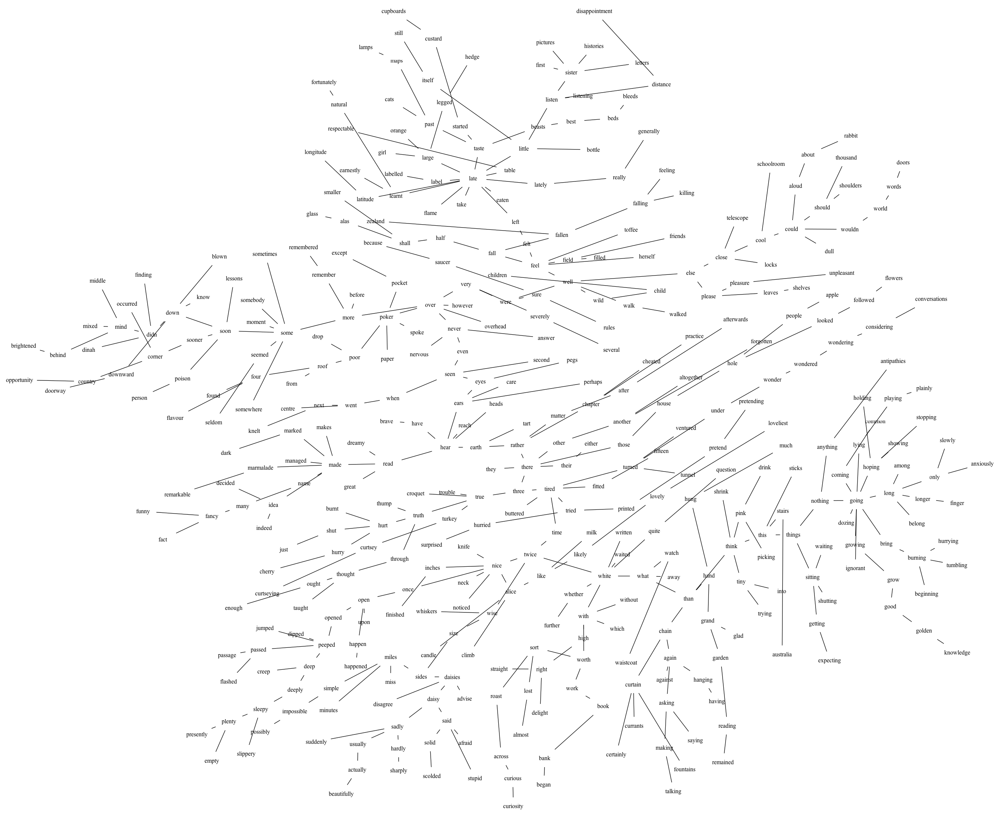

# Delineations: rhizomatic representation of a text

[Examples](../examples.md) · En français : [Délinéations : représentation rhizomatique d'un texte](../exemples/delineations.md)

F. Voisin, October 2026 (2013). Script: [lisp/delineations.lisp](../lisp/delineations.lisp).

*An analysis kept with its data in the [fv-morphologie](https://github.com/FredVoisin/fv-morphologie) repository; it is rewritten here in Common Lisp, and applied to* Alice's Adventures in Wonderland *by Lewis Carroll.*

A text is reduced to its words, and the words are linked by how alike they
are written: the minimum spanning tree of their edit distances gives a
*rhizomatic* representation of the text, where neighbouring words are written
in a similar way, without anything known of their meaning or of their place
in the text.

The tree of an excerpt of Gilles Deleuze's *Différence et répétition*,
computed with this method, was published in Frédéric Voisin, « De la brousse
dans les synthés », in Pascale Criton and Jean-Marc Chouvel (eds.), *Gilles
Deleuze : la pensée-musique*, Paris, CDMC, 2015, pp. 231–240 (HAL
[hal-01611947](https://hal.science/hal-01611947v1)).

## The method

1. A text (7-bit ASCII) is read into a list of words with `read-text`, all
   punctuation being separators (`:sep`) and words of less than four letters
   being removed (`:rem-test`). Here, the words are also put in lower case:
   "Alice" and "ALICE" are the same word.
2. Repeated words are removed; words differing by at most one character are
   considered identical, using the edit distance as test of
   `remove-duplicates`. The first one met in the text is kept.
3. The semi-matrix of the edit distances between the words gives the minimum
   spanning tree (`graph-span`). `:uncom` maximizes the distance between
   words with uncommon characters, hoping to bring words with the same root
   closer (here `:uncom 1`).
4. `graph>dot` draws the tree with neato.

## Alice's Adventures in Wonderland

The text, [data/Alice.txt](../data/Alice.txt) (*The Millennium Fulcrum
Edition 2.9*, public domain), has 14,152 words of four letters or more, 2,352
distinct ones, and 1,754 after merging the words one character apart. The
merging keeps the first word met: "queen" becomes "queer", "hatter"
"matter", and "mouse" "house". The whole book is computed in about ten
seconds (the semi-matrix of 1.5 million distances in 5 s, the tree in less
than a second), and drawn by neato in seven seconds.

The edges of the tree measure from 2 to 13 (the edit distance, increased by 1
for each substitution of a letter that the other word does not have); most
of them measure 4 or 5. The nodes of highest degree are short and ordinary
words, which many others resemble: *late* (16 neighbours), *going* (14),
*nice* (10), *burning*, *hear*, *peeped*, *seen* (9).

The tree of the whole book, to be zoomed:
[pictures/delineations-alice.svg](../pictures/delineations-alice.svg).

The tree of chapter I (*Down the Rabbit-Hole*, 1,113 words, 419 distinct):



A path in the tree (`graph-path`) goes from one word to another through
resemblances of spelling, like a chain of puns:

- from *rabbit* to *queer* (*queen*): rabbit — brain — bring — grin — going —
  king — making — asking — shaking — shining — singing — sitting — strings —
  things — this — sits — suit — quite — quiver — queer;
- from *alice* to *turtle*: alice — nice — once — ones — seen — lessen —
  less — else — tells — tales — teases — taste — past — salt — shall —
  seals — ears — hear — hers — there — three — true — turtle.

## Variants and references

Variants: normalized edit distances with a logarithmic scaling of the
distances; the sum of the edit distance and of the distance between the
word frequencies ("the sum of two distances is a distance — is the product of
two distances a distance?"). For large graphs, prefer the svg format.
Computing the spanning tree can take from seconds to hours depending on the
number of elements (about 12 hours for the
[« Délinéations différentielles »](https://fredvoisin.com/articles/220-delineations-differentielles.html), 2013).
Data: [data/Alice.txt](../data/Alice.txt) (Lewis Carroll, public domain), and two protected
texts, kept in the fv-morphologie repository and not covered by the license of
refrains: an excerpt of Gilles Deleuze, *Différence et répétition*
([Difference&Repetition-utf8.txt](https://github.com/FredVoisin/fv-morphologie/blob/master/pwgl-legacy/tutorial/5.%20FV-exemples/data/Difference%26Repetition-utf8.txt)), and a quotation of
Arkady and Boris Strugatsky, *Roadside Picnic*
([Stalker.txt](https://github.com/FredVoisin/fv-morphologie/blob/master/pwgl-legacy/tutorial/5.%20FV-exemples/data/Stalker.txt)).

## The code

The code is the documentation (its comments are in French).
[lisp/delineations.lisp](../lisp/delineations.lisp) is loaded from the folder
of the repository, and draws the trees with `neato`
([Graphviz](https://graphviz.org/)):

```lisp
(load "doc/lisp/delineations.lisp")
```

<!-- code: doc/lisp/delineations.lisp -->
```lisp
;;;; delineations.lisp
;;;;
;;;; Délinéations : représentation rhizomatique d'un texte (F. Voisin, 2013), appliquée à
;;;; Alice's Adventures in Wonderland de Lewis Carroll (doc/data/Alice.txt, domaine public).
;;;; Les mots du texte, réduits à leurs formes distinctes, sont reliés par leur distance
;;;; d'édition : l'arbre de recouvrement minimal de ces distances rapproche les mots qui
;;;; s'écrivent de façon semblable, sans rien savoir de leur sens.
;;;;
;;;; (load "doc/lisp/delineations.lisp") affiche les étapes et dessine les arbres avec neato
;;;; (Graphviz) : doc/pictures/delineations-alice.svg (tout le livre) et
;;;; doc/pictures/delineations-alice-ch1.png (le chapitre I).
;;;;
;;;; Copyright (C) 2026 Frédéric Voisin
;;;;
;;;; Ce fichier, exemple de la documentation de refrains, est placé sous licence
;;;; Creative Commons Attribution 4.0 International (CC BY 4.0), comme la
;;;; documentation : voir ../LICENSE ou https://creativecommons.org/licenses/by/4.0/
;;;;
;;;; SPDX-License-Identifier: CC-BY-4.0

(asdf:load-system :refrains)
(in-package :refrains)

(defparameter *doc*
  (uiop:pathname-parent-directory-pathname (uiop:pathname-directory-pathname *load-truename*)))

;;; 1. La lecture : read-text en mode plat (nil) donne la liste des mots du texte, toute la
;;; ponctuation servant de séparateur (:sep t), et les mots de moins de quatre lettres
;;; supprimés (:rem-test). Les mots sont mis en minuscules : « Alice » et « ALICE » sont le
;;; même mot.

(defparameter *mots*
  (mapcar #'string-downcase
          (read-text (merge-pathnames "data/Alice.txt" *doc*)
                     :mode nil :sep t :rem-test (lambda (w) (< (length w) 4)))))

;;; 2. Les mots distincts : les répétitions supprimées, puis les mots qui diffèrent d'au plus
;;; un caractère tenus pour identiques, la distance d'édition servant de test à
;;; remove-duplicates. Le premier mot rencontré dans le texte est gardé (:from-end t).

(defun distincts (mots)
  (remove-duplicates (remove-duplicates mots :test #'string= :from-end t)
                     :test (lambda (a b) (<= (dist-edit a b) 1))
                     :from-end t))

;;; 3. L'arbre : la semi-matrice des distances d'édition entre les mots, dont graph-span
;;; garde l'arbre de recouvrement minimal. :uncom 1 ajoute 1 au coût de la substitution
;;; d'un caractère qui n'est pas commun aux deux mots : il éloigne les mots faits de lettres
;;; différentes, dans l'espoir de rapprocher les mots de même racine. dist-edit numérote les
;;; mots ; les nœuds de l'arbre sont les mots eux-mêmes.

(defun arbre (mots)
  (let ((v (coerce mots 'vector)))
    (mapcar (lambda (e) (list (aref v (first e)) (aref v (second e)) (third e)))
            (graph-span (dist-edit mots nil :uncom 1)))))

;; le chapitre I : les mots du premier « chapter » au suivant
(defun chapitre-1 (mots)
  (let ((debut (position "chapter" mots :test #'string=)))
    (subseq mots debut (position "chapter" mots :test #'string= :start (1+ debut)))))

;;; 4. Le livre entier, puis le chapitre I

(defun delineation (nom mots fichier &rest options)
  (let* ((d (distincts mots))
         (a (arbre d)))
    (format t "~&~%~A : ~D mots, ~D distincts, ~D après la fusion des mots à un caractère près~%"
            nom (length mots) (length (remove-duplicates mots :test #'string=)) (length d))
    (format t "longueurs des arêtes (longueur, nombre) : ~S~%"
            (sort (histogram (mapcar #'third a)) #'< :key #'first))
    (format t "les nœuds de plus haut degré : ~{~{~A (~D)~}~^, ~}~%"
            (mapcar (lambda (x) (list (second x) (first x)))
                    (subseq (stable-sort (mapcar (lambda (n) (list (graph-degree n a) n)) (graph-nodes a))
                                         #'> :key #'first)
                            0 8)))
    (apply #'graph>dot a :out (merge-pathnames fichier *doc*) options)
    (format t "dessin : doc/~A~%" fichier)
    a))

(defparameter *livre*
  (delineation "Le livre" *mots* "pictures/delineations-alice.svg" :shape "plaintext" :legend nil))

(defparameter *chapitre-1*
  (delineation "Le chapitre I" (chapitre-1 *mots*) "pictures/delineations-alice-ch1.png"
               :shape "plaintext" :legend nil :overlap nil))

;;; 5. Un chemin dans l'arbre du livre : de mot en mot, par les ressemblances d'écriture

;; « queen » n'est pas dans l'arbre : à un caractère de « queer », rencontré avant lui dans le
;; texte, il a été fusionné avec lui (comme « hatter » avec « matter », « mouse » avec « house »)
(format t "~&~%De « rabbit » à « queer » (queen) : ~{~A~^ — ~}~%" (graph-path "rabbit" "queer" *livre*))
(format t "De « alice » à « turtle » : ~{~A~^ — ~}~%" (graph-path "alice" "turtle" *livre*))
```
<!-- /code -->

---

This documentation is licensed under the
[Creative Commons Attribution 4.0 International License (CC BY 4.0)](../LICENSE).
