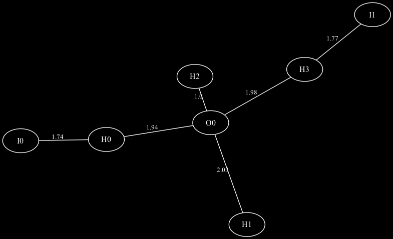
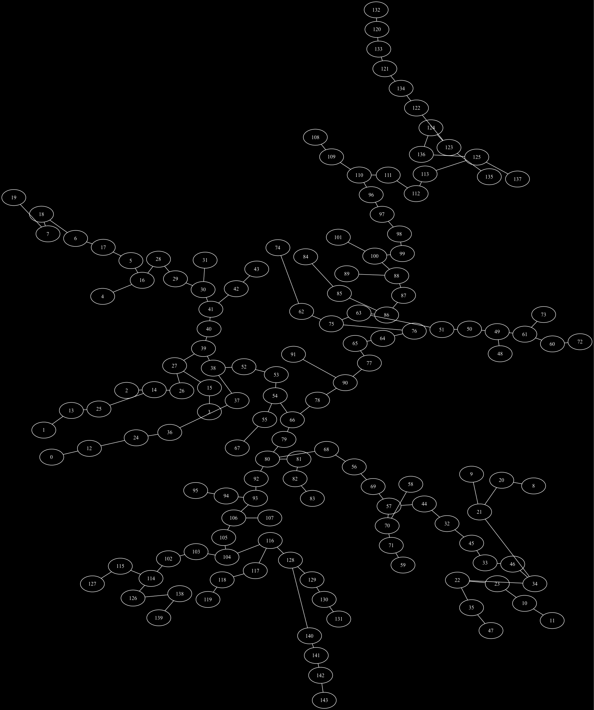

# Trees of neural networks

[Examples](../examples.md) · En français : [Arbres de réseaux de neurones](../exemples/neuromuse.md)

The idea here is to apply refrains to the study of neural networks as
formalized in [neuromuse](https://github.com/FredVoisin/neuromuse), a Common
Lisp library of artificial neural networks for music. Its networks are
already graphs: their method `edges` gives the arcs `(source target weight)`,
almost in the form of the graphs of refrains `(node-a node-b distance)`. This
example explores with refrains a multilayer perceptron and a self-organizing
map. The code is in
[lisp/neuromuse-graphs.lisp](../lisp/neuromuse-graphs.lisp); the results below
are those of SBCL, with the random draws of the script.

## A multilayer perceptron trained on XOR

An MLP with 2 inputs (I0, I1), 4 hidden neurons (H0 to H3) and one output (O0)
learnt XOR (outputs 0.03, 0.98, 0.98, 0.02). Each weight becomes a distance,
|maximal weight| / |weight|: 1 for the strongest connection, a long distance
for a weak one. The sign of the weights (excitation or inhibition) and the
direction of the arcs are lost.

- **The skeleton of the strong connections** (`graph-span`): H2–O0 (1.0),
  I0–H0 (1.74), I1–H3 (1.77), H0–O0 (1.94), H3–O0 (1.98), H1–O0 (2.03).
- **The strongest chain of influence** from I0 to the output (`graph-path`,
  `dist-graph`): I0, H0, O0, of length 3.68.
- **Pruning** (`graph-degree`), keeping only the connections of at least a
  quarter of the maximal weight: H1 has only one connection left, it relays
  nothing any more and could be removed.
- **The resemblance of the hidden neurons** by their input weights
  (`dist-euclidean`, `graph-dendrogram` with Ward's linkage, justified for
  these vectors): H1 and H2 are alike (7.94), then H0 joins them (10.33); H3
  stays apart (14.71).



## A self-organizing map trained on the song of the chaffinch

The map of 12 × 12 neurons of the example `pinson_som.lisp` of neuromuse
learns the spectra (18 frequency bands) of three songs of a chaffinch.

- **The topology of the map.** The minimum spanning tree of the prototypes
  (the weights of each neuron, compared by `dist-euclidean`) has 143 edges, 120
  of which link neighbours on the grid: the map preserves well the topology of
  the space of the sounds.
- **The sequences of winning neurons.** For each frame of a song, the winning
  neuron gives a symbol: the map transcribes the song into a sequence of
  symbols, which refrains analyses. Once the local repetitions are removed
  (`filt-repeat`), the three songs give sequences of 757, 829 and 795 winners,
  with 87, 99 and 92 distinct neurons, and an entropy of 5.6 to 5.7 bits
  (`entropy`).
- **The motifs** (`motif-list`): the most frequent ones of the first song are
  alternations between two neurons, (132 4), (11 4), (4 11), (0 132)…, the
  trace of the trills of the chaffinch on the map.
- **The comparison of the songs** (normalized `dist-edit`): 0.72 to 0.73
  between the three songs.

The file `pinson_som.lisp` of neuromuse considered, to compare the songs, "a
DTW on the sequences of winners". The edit distance of refrains plays this
role: like DTW, it aligns by dynamic programming two sequences of different
lengths and tempos, at a cost of the same order (a matrix of n × m cells). It
compares symbols, though: each cell only needs a test of equality, where a DTW
on the frames would compute a distance between two spectra of 18 bands, and
the differences of tempo are handled by insertions and deletions; removing
the repetitions also shortens the sequences (from 1,249 frames to 757 winners
for the first song). In return, two neighbouring neurons on the map are as
different for it as two distant ones, whereas a DTW on the winners could take
their distance on the grid into account.



See also [Comparing neural networks](neuromuse-comparaison.md): several
networks learning the same thing, compared before and after learning.

## The code

The code is the documentation (its comments are in French).
[lisp/neuromuse-graphs.lisp](../lisp/neuromuse-graphs.lisp) needs the systems
neuromuse and refrains; it is loaded from the directory of the repository,
prints the results and writes its images in `doc/pictures/`:

```lisp
(load "doc/lisp/neuromuse-graphs.lisp")
```

<!-- code: doc/lisp/neuromuse-graphs.lisp -->
```lisp
;;;; neuromuse-graphs.lisp
;;;;
;;;; Les réseaux de neurones de neuromuse étudiés comme des graphes avec refrains :
;;;; 1. un perceptron multicouche (MLP) appris sur le XOR : squelette des connexions,
;;;;    chemin le plus fort, élagage, ressemblance des neurones cachés ;
;;;; 2. une carte auto-organisatrice (SOM) apprise sur le chant du pinson : topologie
;;;;    de la carte, et suites de neurones gagnants analysées comme des suites de
;;;;    symboles (distance d'édition, entropie, motifs).
;;;;
;;;; Demande les systèmes neuromuse (https://github.com/FredVoisin/neuromuse) et
;;;; refrains, trouvables par ASDF. (load "doc/lisp/neuromuse-graphs.lisp") affiche
;;;; les résultats et écrit, dans doc/pictures/, neuromuse-xor.dot/.png et
;;;; neuromuse-pinson.dot/.png. L'apprentissage de la SOM prend environ 20 secondes.
;;;;
;;;; Copyright (C) 2026 Frédéric Voisin
;;;;
;;;; Ce fichier, exemple de la documentation de refrains, est placé sous licence
;;;; Creative Commons Attribution 4.0 International (CC BY 4.0), comme la
;;;; documentation : voir ../LICENSE ou https://creativecommons.org/licenses/by/4.0/
;;;;
;;;; SPDX-License-Identifier: CC-BY-4.0

(asdf:load-system :neuromuse)
(asdf:load-system :refrains)
(in-package :neuromuse)

;; le dossier des images : doc/pictures/, à côté du dossier de ce fichier (doc/lisp/)
(defparameter *pictures*
  (merge-pathnames "pictures/" (uiop:pathname-parent-directory-pathname
                                (uiop:pathname-directory-pathname *load-truename*))))

(defun picture (name) (namestring (merge-pathnames name *pictures*)))

;; des tirages aléatoires reproductibles (poids initiaux, ordre de présentation)
(setf *random-state* #+sbcl (sb-ext:seed-random-state 7) #-sbcl (make-random-state t))

;;; 1. Un MLP appris sur le XOR : 2 entrées, 4 neurones cachés, 1 sortie

(make-mlp xor 2 1 4)

(let ((inputs '((0 0) (1 0) (0 1) (1 1)))
      (goals '((0) (1) (1) (0))))
  (setf (learn-fact xor) .5 (verbose xor) nil)
  (loop repeat 20000
        do (loop for i in inputs for g in goals
                 do (setf (input xor) i (goal xor) g) (learn xor)))
  (format t "~&XOR : ~{~,2F~^ ~}~%"
          (loop for i in inputs
                collect (progn (setf (input xor) i) (run-mlp xor) (car (output xor))))))

;; EDGES (neuromuse) donne les arcs (source cible poids), les noeuds étant notés
;; (couche indice). Pour refrains, les noeuds sont nommés I0, H2, O0... (une liste
;; serait prise pour une liste de noeuds par graph-degree ou graph-path), et chaque
;; poids devient une distance : |poids maximal| / |poids|, 1 pour la connexion la plus
;; forte. Le signe du poids (excitation ou inhibition) et le sens des arcs sont perdus.

(defun node-name (node)
  (format nil "~A~D" (case (first node) (0 "I") (1 "H") (t "O")) (second node)))

(defparameter *weights*
  (mapcar (lambda (e) (list (node-name (first e)) (node-name (second e)) (third e)))
          (edges xor)))

(defparameter *w-max* (reduce #'max *weights* :key (lambda (e) (abs (third e)))))

(defparameter *xor-graph*
  (mapcar (lambda (e)
            (list (first e) (second e)
                  (/ (round (* 100 (/ *w-max* (max 1e-6 (abs (third e)))))) 100.0)))
          *weights*))

;; le squelette des connexions fortes : l'arbre de recouvrement minimal
(format t "~&squelette : ~S~%" (refrains:graph-span *xor-graph*))

;; la chaîne d'influence la plus forte d'une entrée vers la sortie
(format t "~&de I0 à O0 : ~S, longueur ~S~%"
        (refrains:graph-path "I0" "O0" *xor-graph*)
        (refrains:dist-graph "I0" "O0" *xor-graph*))

;; élagage : on ne garde que les connexions d'au moins un quart du poids maximal ;
;; un neurone qui n'a plus qu'une connexion ne relaie plus rien
(let ((strong (remove-if (lambda (e) (> (third e) 4)) *xor-graph*)))
  (format t "~&après élagage : ~{~{~A ~D~}~^, ~}~%"
          (mapcar #'list (refrains:graph-nodes strong) (refrains:graph-degree nil strong))))

;; la ressemblance des neurones cachés, d'après leurs poids d'entrée (des vecteurs
;; euclidiens : le lien de Ward y est justifié)
(format t "~&neurones cachés (Ward) : ~S~%"
        (nth-value 1 (refrains:graph-dendrogram
                      (refrains:dist-euclidean (first (net xor)) nil) :linkage :ward)))

;; le dessin du squelette (le graphe complet, avec ses connexions presque nulles et
;; donc très longues, serait illisible)
(refrains:graph>dot (refrains:graph-span *xor-graph*) :out (picture "neuromuse-xor.png") :invert t)

;;; 2. Une SOM apprise sur le chant du pinson : 12 x 12 neurones, 18 bandes de fréquence

(let ((*standard-output* (make-broadcast-stream))
      (examples (asdf:system-relative-pathname :neuromuse "examples/")))
  (load (merge-pathnames "pinson_vecteurs.lisp" examples))
  (load (merge-pathnames "pinson_som.lisp" examples)))

(train-pinson-som :epochs 10)

;; la topologie : l'arbre de recouvrement minimal des prototypes (les poids de chaque
;; neurone), comparé à la grille ; plus ses arêtes relient des voisins de la grille,
;; mieux la carte préserve la topologie de l'espace des sons
(defparameter *prototypes*
  (mapcar (lambda (neuron) (mapcar #'third (edges neuron))) (net pinson-som)))

(defparameter *prototypes-tree*
  (refrains:graph-span (refrains:dist-euclidean *prototypes* nil)))

(let ((grid (grid-neighbour-pairs pinson-som)))
  (format t "~&arbre des prototypes : ~D arêtes, dont ~D entre voisins de la grille~%"
          (length *prototypes-tree*)
          (count-if (lambda (e) (member (list (min (first e) (second e)) (max (first e) (second e)))
                                        grid :test #'equal))
                    *prototypes-tree*)))

(refrains:graph>dot *prototypes-tree* :out (picture "neuromuse-pinson.png")
                    :overlap nil :invert t :legend nil)

;; les suites de neurones gagnants de chaque chant, sans les répétitions locales :
;; la SOM transcrit le son en suites de symboles, que refrains compare et analyse
(defparameter *winners*
  (mapcar (lambda (chant) (refrains:filt-repeat (winner-sequence chant))) *pinson-chants*))

(format t "~&gagnants : ~{~D~^, ~} ; début du chant 1 : ~S~%"
        (mapcar #'length *winners*) (subseq (first *winners*) 0 20))

;; la distance d'édition compare des suites de longueurs et de tempos différents :
;; c'est le DTW sur les suites de gagnants qu'envisageait pinson_som.lisp
(format t "~&distances d'édition normalisées : 1-2 ~,2F, 1-3 ~,2F, 2-3 ~,2F~%"
        (refrains:dist-edit (first *winners*) (second *winners*) :norm t)
        (refrains:dist-edit (first *winners*) (third *winners*) :norm t)
        (refrains:dist-edit (second *winners*) (third *winners*) :norm t))

(format t "~&entropie (bits) : ~{~,2F~^, ~} ; neurones gagnants : ~{~D~^, ~}~%"
        (mapcar #'refrains:entropy *winners*)
        (mapcar (lambda (s) (length (remove-duplicates s))) *winners*))

;; les motifs les plus fréquents du premier chant, de 2 à 4 gagnants
(format t "~&motifs du chant 1 : ~{~S~^ ~}~%"
        (mapcar #'first (subseq (refrains:motif-list (first *winners*) :freq :n '(2 4)) 0 6)))
```
<!-- /code -->

---

This documentation is licensed under the
[Creative Commons Attribution 4.0 International License (CC BY 4.0)](../LICENSE).
