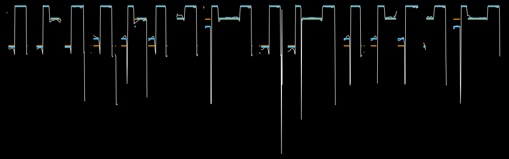
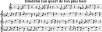

# Quantifier une F0 : *Hìndèhú*

[Exemples](../exemples.md) · In English: [Quantizing an F0: *Hìndèhú*](../examples/hindehu.md)

F. Voisin, 2026 (enregistrement : S. Arom, V. Dehoux, S. Fürniss et F. Voisin, Centrafrique, 1989).

Cet exemple montre comment quantifier des données brutes de détection de hauteur (F0)
afin de les interpréter et de les transcrire sous la forme d'une partition.

Il s'agit ici d'un court extrait (12 s) de *Hìndèhú* des Aka de Centrafrique, où 
alternent voix et *mòbéké*, instrument constitué de deux sifflets taillés dans du bambou.
La fréquence fondamentale (F0) et l'intensité de l'enregistrement a été détectée
toutes les 10 ms, avec l'algorithme YIN (de Cheveigné et Kawahara, 2002), entre 
60 et 1000 Hz : [data/hindehu-f0.txt](../data/hindehu-f0.txt), où chaque ligne 
donne la temps (en s), la F0 (en Hz, ou 0 si la trame n'est pas voisée) et intensité (en dB). 
L'extrait lui-même (filtré) est le fichier [data/hindehu.mp3](../data/hindehu.mp3).


On se propose de quantifier la F0 avec les fonctions de refrains :
- selon ses propres centres d'attraction avec `filt-quantize` (voir [1.2](../refrains.fr.md#12-filtrer)),
- sur l'ensemble et sur une fenêtre glissante, puis par notes avec `class-num`
et `histogram`
- et de transcrire les données quantifiées au moyen de LilyPond (`seq>ly`), au quart de ton,
et en notation ABC (`seq>abc`).

## 1. Aperçu des données

Les données sont d'abord lues avec la fonction `read-text`. Chaque fréquence 
est convertie en note MIDI, 69 + 12 log₂(f / 440), `nil` dans les trames 
non voisées ; `seq>plot` trace une liste de nombres comme un flux d'une seule 
valeur, chaque trame à son rang :

```lisp
(defparameter *trames* (read-text "doc/data/hindehu-f0.txt"))   ; (temps F0 intensité)
(defparameter *notes* (mapcar (lambda (trame) (note-midi (second trame))) *trames*))

(seq>plot *notes* :height 14)
```
```
74.783
 **  **  *** *** **  ***  *****   **  *** *   **  **  **  *** *** **  **
*     **          ***   **    *****        ****        **    **    **** 
      **          *         **                                   **     
            **  **  **                           **  **  ** *           
******  ** *** * *   * *   *       **** ***    *   **        *  *      *
               *       *                           *                    
                                                                        
                 *                      *         *   *   *     * *     
           *        *                                                   
                *            *                  *                 *     
                                           *                            
        *                                                               
                                                                        
                                        *                               
38.24
4                                                                   1192
```

1203 trames, dont 1006 voisées. Les notes forment des paliers nets entre 62 et
75, avec quelques valeurs isolées bien plus bas (jusqu'à 38). L'intensité,
`(seq>plot (mapcar #'third *trames*) :height 8)`, montre des notes séparées par
des creux :

```
-8.9
                             *                                  **      
**  **  **       ***        **       *  **       *   *  **      ** * *  
*** ******* *** ******* ***********  ********************** *********** 
*** ******* *********** ******** **********  * * * ******** ** ****  ** 
***  * ****  * * *   ** ** *  *  * *   * *   * *** * *  ** **  *     * *
*  *    *  **  *    *  *   **      *   *       *   **   *  **  **      *
   **   *  **  **   *  **  **      **  **      **   *      **  **      *
*              **      **               *       *               *      *
-64.7
0                                                                   1202
```

## 2. Les valeurs basses

`class-num` en 2 niveaux, avec `:1d-centroids`, coupe au plus grand écart
entre les valeurs triées : il sépare 25 valeurs basses de toutes les autres,
qui commencent à 62. Elles ne sont pas modifiées ; on regarde seulement où
elles tombent et avec quelle intensité :

```lisp
(defparameter *registre*            ; la plus basse valeur de la classe haute
  (let* ((valeurs (remove nil *notes*))
         (classes (first (class-num valeurs 2 :1d-centroids :sort t))))
    (reduce #'min (loop for v in valeurs for c in classes when (= c 1) collect v))))
```
```
25 valeurs sous 62.0 (position, note, intensité) :
137 42.9 -48.8 |
192 51.3 -52.8 |
193 51.2 -54.7 |
268 50.3 -61.6 |
269 50.3 -61.0 |
270 50.3 -61.4 |
271 50.5 -61.6 |
294 55.5 -38.9 |
342 52.1 -54.5 |
496 50.6 -31.8 |
497 50.6 -31.7 |
666 38.2 -57.3 |
668 55.2 -59.6 |
714 46.7 -30.0 |
796 50.3 -56.8 |
797 50.3 -57.2 |
831 55.1 -39.0 |
832 55.6 -38.2 |
897 55.5 -34.9 |
963 55.3 -37.0 |
964 55.6 -33.3 |
1063 55.1 -54.0 |
1064 55.1 -55.7 |
1097 50.6 -31.1 |
1098 55.9 -30.5
```

Elles durent une à quatre trames (10 à 40 ms) et tombent toutes au bord d'une
note : à sa fin, faibles (de -48 à -62 dB), quand la note s'éteint, ou au
passage d'une note à la suivante, plus fortes (de -30 à -39 dB). Ce ne sont pas
des notes tenues : plutôt des transitions, où la détection s'accroche parfois à
un sous-harmonique (55,5 est une octave sous 67,5, 50,3 sous 62,3).

## 3. Quantifier

`filt-quantize` remplace chaque valeur par le centre de sa classe, par le
temps passé (`:1d-centroids`, les nuées dynamiques sur toutes les trames) ou
par les retournements (`:mode :minmax`, `class-num` sur les seuls minima et
maxima, chaque retournement comptant une fois, puis chaque valeur au centre le
plus proche) :

```lisp
(dolist (n '(5 6 7 8 9 10))
  (let ((duree (filt-quantize *notes* n))
        (retournements (filt-quantize *notes* n :mode :minmax)))
    ...))
```
```
 5 niveaux : par le temps passé 38.2 42.9 46.7 52.8 71.1 (erreur 3.16)
    par les retournements 38.2 42.9 46.7 53.1 70.9 (erreur 3.22)
 6 niveaux : par le temps passé 38.2 42.9 46.7 52.8 64.8 73.1 (erreur 1.51)
    par les retournements 38.2 42.9 46.7 53.1 64.1 73.1 (erreur 1.50)
 7 niveaux : par le temps passé 38.2 42.9 46.7 50.7 55.4 64.8 73.1 (erreur 1.46)
    par les retournements 38.2 42.9 46.7 50.9 55.3 64.1 73.1 (erreur 1.46)
 8 niveaux : par le temps passé 38.2 42.9 46.7 50.6 52.1 55.4 64.8 73.1 (erreur 1.46)
    par les retournements 38.2 42.9 46.7 50.9 55.3 63.1 67.7 73.3 (erreur 1.24)
 9 niveaux : par le temps passé 38.2 42.9 46.7 50.4 51.2 52.1 55.4 64.8 73.1 (erreur 1.46)
    par les retournements 38.2 42.9 46.7 50.6 52.1 55.3 63.1 67.7 73.3 (erreur 1.24)
10 niveaux : par le temps passé 38.2 42.9 46.7 50.4 51.2 52.1 55.4 64.8 71.3 74.4 (erreur 0.58)
    par les retournements 38.2 42.9 46.7 50.4 51.2 52.1 55.3 63.1 67.7 73.3 (erreur 1.24)
```

`:1d-centroids` part des plus grands écarts entre les valeurs triées : ceux
qui isolent les valeurs basses. En 5 niveaux, quatre vont à ces 25 trames, et
un seul (71,1) à toutes les notes ; il faut 10 niveaux pour que les notes se
répartissent à nouveau, sur 64,8, 71,3 et 74,4 (erreur moyenne de 0,58
demi-ton). Par les retournements, la répartition reste moins bonne : quelques
trames isolées suffisent à occuper des niveaux, parce que chaque retournement
compte, si bref soit-il.

Sur une fenêtre glissante d'un quart de l'extrait (`:window 1/4`, pas d'une
demi-fenêtre), en 10 niveaux :

```lisp
(filt-quantize *notes* 10 :window 1/4 :out :all)   ; la troisième valeur : (début fin centres)
```
```
fenêtre    0- 300 : 42.9 50.4 51.2 55.5 63.7 65.6 66.9 71.0 72.9 74.4
fenêtre  150- 450 : 50.4 51.2 52.1 55.5 62.6 64.3 65.2 66.8 71.4 74.4
fenêtre  300- 600 : 50.6 52.1 62.4 63.4 65.0 66.5 69.6 71.5 73.2 74.4
fenêtre  450- 750 : 38.2 46.7 50.6 55.2 62.7 64.0 69.4 71.5 73.4 74.4
fenêtre  600- 900 : 38.2 46.7 50.3 55.2 55.6 62.8 64.0 66.7 71.5 74.4
fenêtre  750-1050 : 50.3 55.4 62.3 63.1 64.1 65.3 66.6 71.7 73.0 74.4
fenêtre  900-1200 : 50.6 55.4 62.3 64.1 65.3 66.4 69.5 71.7 73.3 74.4
fenêtre  902-1202 : 50.6 55.4 62.3 64.1 65.3 66.4 69.5 71.7 73.3 74.4
```

Les niveaux hauts, 74,4 et 71,5 environ, sont les mêmes partout : ce sont ceux
des notes longues. Les autres varient d'une fenêtre à l'autre, selon les
valeurs basses et les transitions qu'elle contient.

## 4. Par notes

Quantifiées trame par trame, les notes brèves pèsent peu, et les détections
faibles (la respiration, les attaques, les extinctions) prennent des niveaux.
On passe donc aux notes : les minima très courts (voir [2](#2-les-valeurs-basses))
sont ignorés, devenant `nil` sans changer d'octave ; chaque suite de trames
voisées entre deux silences est une note, de hauteur médiane ; les suites
faibles, sous -45 dB en moyenne, sont écartées ; puis `class-num` classe les
notes, chacune comptant une fois, quelle que soit sa durée :

```lisp
(defparameter *notes-jouees*        ; (début fin hauteur intensité)
  (loop for (debut fin) in (suites *sans-minima*)
        for intensite = (moyenne (subseq *intensites* debut (1+ fin)))
        when (>= intensite *seuil*)
          collect (list debut fin (mediane (subseq *sans-minima* debut (1+ fin))) intensite)))

(defparameter *niveaux*
  (second (class-num (mapcar #'third *notes-jouees*) 5 :1d-centroids :sort t)))
```
```
23 notes ; 5 niveaux (nombre de notes, durée moyenne en ms) :
  64.60 : 2 notes, 195 ms
  66.62 : 4 notes, 152 ms
  69.50 : 2 notes, 155 ms
  71.65 : 6 notes, 713 ms
  74.29 : 9 notes, 441 ms
```

Cinq notes : deux graves et courtes (64,6 et 66,6), une courte un peu sous
les deux hautes (69,5), et deux hautes et longues (71,6 et 74,3). Les suites
faibles écartées (13, de 10 à 40 ms, de -48 à -62 dB) sont nettement séparées
des notes (de -17 à -34 dB) ; une seule est entre les deux, à -42,5 dB (une
note de 60 ms à 1008), gardée par le seuil.

`histogram` le confirme, sans arrondir les hauteurs : avec une grille de
centres au quart de ton (`:thes`) et un test de tolérance d'un huitième de ton
(`:test`), il compte les trames autour de chaque centre :

```lisp
(histogram (remove nil *sans-minima*)
           :thes (loop for c from 62 to 75 by 1/2 collect c)
           :test (lambda (c x) (< (abs (- c x)) 1/4)))
```
```
au quart de ton : ((62 9) (125/2 25) (63 21) (127/2 12) (64 47) (129/2 25)
                   (65 3) (131/2 5) (66 21) (133/2 26) (67 38) (135/2 4) (68 0)
                   (137/2 0) (69 5) (139/2 26) (70 2) (141/2 15) (71 49)
                   (143/2 143) (72 58) (145/2 8) (73 8) (147/2 4) (74 68)
                   (149/2 358) (75 1))
```

Les pics les plus nets sont entre deux demi-tons tempérés : 74,5 (358 trames),
71,5 (143), 69,5 (26), puis 66,5–67 et 64. L'échelle n'est pas tempérée : ses
écarts mesurés, de 2,0, 2,9, 2,15 et 2,65 demi-tons, sont à peu près ceux
d'une échelle pentatonique sans demi-tons (2, 3, 2, 3), placée environ un
quart de ton au-dessus du tempéré en la 440.

La transcription prend ensuite, pour chaque trame (hors minima très courts),
le plus proche des cinq niveaux, au quart de ton, les centres restant fixes.
Une suite voisée peut ainsi contenir plusieurs notes enchaînées, sans
silence entre elles, que sa seule médiane cachait. Les segments de moins de
50 ms (5 trames), glissements entre deux notes ou détections faibles,
deviennent des silences :

```lisp
(defparameter *transcription*
  (let* ((par-trame (mapcar (lambda (v) (when v (quart-de-ton (niveau v)))) *sans-minima*))
         (transcription (copy-list par-trame)))
    (dolist (s (segments par-trame) transcription)      ; (début fin niveau)
      (when (< (1+ (- (second s) (first s))) *duree-minimale*)
        (loop for i from (first s) to (second s) do (setf (nth i transcription) nil))))))
```
```
41 notes (début, durée en ms, niveau au quart de ton) :
   8  160 64.5
  24  280 74.5
  76  160 64.5
  92  150 74.5
 110  220 71.5
 144  160 64.5
 160  300 74.5
 213  140 66.5
 230  280 74.5
 280  130 66.5
 296  150 74.5
 311   50 69.5
 316  260 71.5
 345  160 66.5
 364  240 74.5
 414  190 71.5
 433  290 74.5
 482  140 69.5
 498  160 74.5
 514  520 71.5
 566  280 74.5
 617  200 64.5
 637  270 74.5
 681  190 64.5
 700  140 74.5
 715  500 71.5
 765  300 74.5
 816  150 66.5
 833  240 74.5
 881  150 66.5
 898  170 74.5
 915  280 71.5
 946  160 66.5
 965  310 74.5
1008   60 64.5
1015  190 71.5
1034  280 74.5
1080  170 69.5
1099  150 74.5
1114  490 71.5
1163  290 74.5
```

Une figure revient sans cesse : une note brève et grave (64,5, 66,5 ou 69,5,
de 130 à 200 ms), puis un saut vers 74,5 (de 150 à 300 ms), souvent suivi
d'un 71,5 plus long (jusqu'à 520 ms) et d'un retour sur 74,5.



## 5. La transcription

Chaque note dure son nombre de trames divisé par 5, en doubles croches (une
double croche pour 50 ms), les silences devenant des silences.

Les cinq niveaux tombent environ un quart de ton au-dessus des demi-tons
tempérés (en la 440) : 64,5, 66,5, 69,5, 71,5 et 74,5. Pour simplifier la
lecture, la mélodie est **descendue d'un quart de ton** : chaque note tombe
alors sur un demi-ton, mi, fa♯, la, si et ré, et le titre le précise. Aux
hauteurs mesurées, `seq>ly` écrirait un quart de ton plus haut `ih` (74,5
serait `dih''`) ; `seq>abc`, qui arrondit au demi-ton, couperait l'échelle
entre deux demi-tons.

```lisp
(defparameter *plus-bas* (mapcar (lambda (n) (when n (- n 1/2))) *transcription*))
(defparameter *titre* "Hìndèhú (un quart de ton plus bas)")
```

**Pour LilyPond** : `seq>ly` écrit le texte, et produit la partition si
`lilypond` est installé :

```lisp
(seq>ly *plus-bas* :title *titre* :rhythm t :unit 5 :out "doc/pictures/hindehu-partition.svg")
```

```lilypond
\version "2.24.0"
\header { title = "Hìndèhú (un quart de ton plus bas)" tagline = ##f }
\score {
  {
    \cadenzaOn
    r8 e'8~ e'16 d''4~ d''8 r4 r16 e'8~ e'16 d''8~ d''16 r16 b'4 \bar ""
    r8 e'8~ e'16 d''4~ d''8 r4 r16 fis'8~ fis'16 r16 d''4~ d''8 r4 \bar ""
    fis'8~ fis'16 r16 d''8~ d''16 a'16 b'4~ b'16 r16 fis'8~ fis'16 r16 \bar ""
    d''4~ d''16 r4 r16 b'4 d''4~ d''8 r4 a'8~ a'16 r16 d''8~ d''16 \bar ""
    b'2~ b'8 d''4~ d''8 r4 r16 e'4 d''4~ d''16 r8 r16 e'4 d''8~ d''16 \bar ""
    r16 b'2~ b'8 d''4~ d''8 r4 fis'8~ fis'16 r16 d''4~ d''16 r4 r16 \bar ""
    fis'8~ fis'16 r16 d''8~ d''16 b'4~ b'8 r16 fis'8~ fis'16 r16 d''4~ d''8 \bar ""
    r8 e'16 r16 b'4 d''4~ d''8 r4 a'8~ a'16 r16 \bar ""
    d''8~ d''16 b'2~ b'8 d''4~ d''8 r8 \bar ""
  }
  \layout { \context { \Staff \accidentalStyle forget \omit TimeSignature } }
}
```



**En ABC** :

```lisp
(seq>abc *plus-bas* :title *titre* :rhythm t :unit 5)
```

```abc
X:1
T:Hìndèhú (un quart de ton plus bas)
M:none
L:1/16
K:C
z2 E3 d6 z5 E3 d3 z B4 z2 E3 d6 z5 ^F3 z d6 z4
^F3 z d3 A B5 z ^F3 z d5 z5 B4 d6 z4 A3 z d3
B10 d6 z5 E4 d5 z3 E4 d3 z B10 d6 z4 ^F3 z d5 z5
^F3 z d3 B6 z ^F3 z d6 z2 E z B4 d6 z4 A3 z
d3 B10 d6 z2
```

([pictures/hindehu.abc](../pictures/hindehu.abc),
[pictures/hindehu-partition.ly](../pictures/hindehu-partition.ly))

## Le code

Le code est la documentation.
[lisp/hindehu.lisp](../lisp/hindehu.lisp) se charge depuis le dossier du dépôt,
affiche les résultats et écrit sa figure (SVG), sa transcription (ABC,
LilyPond) et, si `lilypond` est installé, sa partition (SVG) dans
`doc/pictures/` :

```lisp
(load "doc/lisp/hindehu.lisp")
```

<!-- code: doc/lisp/hindehu.lisp -->
```lisp
;;;; hindehu.lisp
;;;;
;;;; Quantifier une fréquence fondamentale (F0) mesurée : un extrait de Hìndèhú, des Aka
;;;; (Centrafrique), voix et mòbéké alternés, enregistré par S. Arom, V. Dehoux,
;;;; S. Fürniss et F. Voisin en 1989.
;;;; La F0 a été mesurée toutes les 10 ms (algorithme YIN, de 60 à 1000 Hz), avec
;;;; l'intensité : doc/data/hindehu-f0.txt, une ligne par trame (temps en s, F0 en Hz ou 0
;;;; si la trame n'est pas voisée, intensité en dB). La F0, telle que détectée, est
;;;; quantifiée par filt-quantize, sur l'ensemble et sur une fenêtre glissante, puis par
;;;; notes, et transcrite en notation ABC et pour LilyPond.
;;;;
;;;; (load "doc/lisp/hindehu.lisp") affiche les résultats et écrit sa figure (svg), sa
;;;; transcription (abc, ly) et, si lilypond est installé, sa partition (svg) dans
;;;; doc/pictures/.
;;;;
;;;; Copyright (C) 2026 Frédéric Voisin
;;;;
;;;; Ce fichier, exemple de la documentation de refrains, est placé sous licence
;;;; Creative Commons Attribution 4.0 International (CC BY 4.0), comme la
;;;; documentation : voir ../LICENSE ou https://creativecommons.org/licenses/by/4.0/
;;;;
;;;; SPDX-License-Identifier: CC-BY-4.0

(asdf:load-system :refrains)
(in-package :refrains)

(defparameter *doc*
  (uiop:pathname-parent-directory-pathname (uiop:pathname-directory-pathname *load-truename*)))

;;; 1. La détection : read-text lit chaque ligne comme une liste (temps F0 intensité)

(defparameter *trames*
  (read-text (namestring (merge-pathnames "data/hindehu-f0.txt" *doc*))))

(defun note-midi (f)
  "La fréquence F (Hz) en note MIDI (69 : la 440 Hz), NIL si F est 0 (trame non voisée)."
  (when (plusp f) (+ 69 (* 12 (log (/ f 440) 2)))))

;; les notes, une par trame de 10 ms, NIL dans les trames non voisées
(defparameter *notes* (mapcar (lambda (trame) (note-midi (second trame))) *trames*))
(defparameter *intensites* (mapcar #'third *trames*))

(format t "~&~D trames de 10 ms, ~D voisées ; notes MIDI de ~,1F à ~,1F~%"
        (length *notes*) (count-if #'identity *notes*)
        (reduce #'min (remove nil *notes*)) (reduce #'max (remove nil *notes*)))

;;; 2. Regarder : les notes, puis l'intensité

(seq>plot *notes* :height 14)
(seq>plot *intensites* :height 8)

;;; 3. Les valeurs basses : class-num en 2 niveaux coupe au plus grand écart entre les
;;; valeurs triées, qui sépare quelques valeurs basses de toutes les autres. Elles ne sont pas
;;; modifiées : on regarde seulement où elles tombent, combien de trames elles durent et avec
;;; quelle intensité

(defparameter *registre*
  ;; la plus basse valeur de la classe haute
  (let* ((valeurs (remove nil *notes*))
         (classes (first (class-num valeurs 2 :1d-centroids :sort t))))
    (reduce #'min (loop for v in valeurs for c in classes when (= c 1) collect v))))

(format t "~&~D valeurs sous ~,1F (position, note, intensité) :~%"
        (count-if (lambda (v) (and v (< v *registre*))) *notes*) *registre*)
(loop for v in *notes* for db in *intensites* for i from 0
      when (and v (< v *registre*))
        do (format t "~4D ~4,1F ~5,1F | " i v db))

;;; 4. Quantifier : par le temps passé (:1d-centroids) et par les retournements (:minmax),
;;; de 5 à 10 niveaux

(defun erreur (notes quantifiees)
  "L'écart moyen, en demi-tons, entre les notes et leur version quantifiée (NIL exclus)."
  (let ((ecarts (loop for a in notes for b in quantifiees when a collect (abs (- a b)))))
    (/ (reduce #'+ ecarts) (length ecarts))))

(defun niveaux (quantifiees)
  (sort (remove-duplicates (remove nil quantifiees) :test #'=) #'<))

(dolist (n '(5 6 7 8 9 10))
  (let ((duree (filt-quantize *notes* n))
        (retournements (filt-quantize *notes* n :mode :minmax)))
    (format t "~&~2D niveaux : par le temps passé ~{~,1F~^ ~} (erreur ~,2F)~%    par les retournements ~{~,1F~^ ~} (erreur ~,2F)~%"
            n (niveaux duree) (erreur *notes* duree)
            (niveaux retournements) (erreur *notes* retournements))))

;; sur une fenêtre glissante d'un quart (pas d'une demi-fenêtre) : les niveaux de chaque fenêtre
(multiple-value-bind (quantifiees classes fenetres) (filt-quantize *notes* 10 :window 1/4 :out :all)
  (declare (ignore quantifiees classes))
  (dolist (f fenetres)
    (format t "~&fenêtre ~4D-~4D : ~{~,1F~^ ~}~%" (first f) (second f) (third f))))

;;; 5. Par notes : quantifiées trame par trame, les notes brèves pèsent peu, et les détections
;;; faibles (la respiration, les attaques) prennent des niveaux. On passe donc aux notes :
;;; les minima très courts sont ignorés (NIL), chaque suite de trames voisées entre deux
;;; silences est une note, de hauteur médiane ; les suites faibles sont écartées ; puis
;;; class-num classe les notes, chacune comptant une fois, quelle que soit sa durée

(defparameter *sans-minima*
  (mapcar (lambda (v) (when (and v (>= v *registre*)) v)) *notes*))

(defun suites (valeurs)
  "Les suites (début fin) de VALEURS entre deux NIL."
  (let ((suites nil) (debut nil))
    (loop for v in (append valeurs (list nil)) for i from 0
          do (cond ((and v (null debut)) (setf debut i))
                   ((and (null v) debut) (push (list debut (1- i)) suites) (setf debut nil))))
    (nreverse suites)))

(defun mediane (valeurs)
  (nth (floor (length valeurs) 2) (sort (copy-list valeurs) #'<)))

(defun moyenne (valeurs) (/ (reduce #'+ valeurs) (length valeurs)))

;; les suites faibles (sous -45 dB en moyenne) sont la respiration, une attaque, une
;; extinction ; les autres sont les notes : (début fin hauteur intensité)
(defparameter *seuil* -45)

(defparameter *notes-jouees*
  (loop for (debut fin) in (suites *sans-minima*)
        for intensite = (moyenne (subseq *intensites* debut (1+ fin)))
        when (>= intensite *seuil*)
          collect (list debut fin (mediane (subseq *sans-minima* debut (1+ fin))) intensite)))

;; les cinq niveaux : class-num sur les hauteurs des notes
(defparameter *niveaux*
  (second (class-num (mapcar #'third *notes-jouees*) 5 :1d-centroids :sort t)))

(defun niveau (hauteur)
  "Le niveau le plus proche de HAUTEUR."
  (reduce (lambda (a b) (if (< (abs (- hauteur a)) (abs (- hauteur b))) a b)) *niveaux*))

(format t "~&~D notes ; 5 niveaux (nombre de notes, durée moyenne en ms) :~%" (length *notes-jouees*))
(dolist (n *niveaux*)
  (let ((durees (loop for (debut fin hauteur) in *notes-jouees*
                      when (= (niveau hauteur) n) collect (* 10 (1+ (- fin debut))))))
    (format t "  ~,2F : ~D notes, ~D ms~%" n (length durees) (round (moyenne durees)))))

;; la grille au quart de ton : histogram compte les trames autour de chaque centre (:thes), à
;; moins d'un huitième de ton (:test), sans arrondir les hauteurs
(defun quart-de-ton (x) (/ (round (* 2 x)) 2))

(format t "~&au quart de ton : ~S~%"
        (histogram (remove nil *sans-minima*)
                   :thes (loop for c from 62 to 75 by 1/2 collect c)
                   :test (lambda (c x) (< (abs (- c x)) 1/4))))

;; la transcription : chaque trame (hors minima très courts) prend le plus proche des cinq
;; niveaux, au quart de ton, centres fixes ; une suite voisée peut ainsi contenir plusieurs
;; notes enchaînées. Les segments de moins de 50 ms (5 trames) sont des glissements entre
;; deux notes ou des détections faibles : ils deviennent des silences

(defparameter *duree-minimale* 5)

(defun segments (valeurs)
  "Les suites (début fin valeur) de VALEURS égales consécutives, hors NIL."
  (let ((segments nil) (debut nil))
    (loop for v in (append valeurs (list nil)) for i from 0
          do (cond ((and v (null debut)) (setf debut i))
                   ((and debut (not (eql v (nth debut valeurs))))
                    (push (list debut (1- i) (nth debut valeurs)) segments)
                    (setf debut (when v i)))))
    (nreverse segments)))

(defparameter *transcription*
  (let* ((par-trame (mapcar (lambda (v) (when v (quart-de-ton (niveau v)))) *sans-minima*))
         (transcription (copy-list par-trame)))
    (dolist (s (segments par-trame) transcription)
      (when (< (1+ (- (second s) (first s))) *duree-minimale*)
        (loop for i from (first s) to (second s) do (setf (nth i transcription) nil))))))

(format t "~&~D notes (début, durée en ms, niveau au quart de ton) :~%~{~{~4D ~4D ~,1F~}~%~}"
        (length (segments *transcription*))
        (mapcar (lambda (s) (list (first s) (* 10 (1+ (- (second s) (first s)))) (float (third s))))
                (segments *transcription*)))

;;; 6. La transcription, avec le rythme : chaque note dure son nombre de trames divisé par 5, en
;;; doubles croches (une double croche pour 50 ms). Pour simplifier la lecture, la mélodie est
;;; descendue d'un quart de ton : chaque note tombe alors sur un demi-ton tempéré (mi, fa#, la,
;;; si, ré), et le titre le précise. Pour LilyPond, avec la partition (svg) si lilypond est
;;; installé ; en ABC

(defparameter *plus-bas* (mapcar (lambda (n) (when n (- n 1/2))) *transcription*))
(defparameter *titre* "Hìndèhú (un quart de ton plus bas)")

(format t "~&~A" (seq>ly *plus-bas* :title *titre* :rhythm t :unit 5))
(handler-case (seq>ly *plus-bas* :title *titre* :rhythm t :unit 5
                                 :out (merge-pathnames "pictures/hindehu-partition.svg" *doc*))
  (error (c) (format t "~&~A~%" c)))

(format t "~&~A" (seq>abc *plus-bas* :title *titre* :rhythm t :unit 5))
(seq>abc *plus-bas* :title *titre* :rhythm t :unit 5 :out (merge-pathnames "pictures/hindehu.abc" *doc*))

;;; 7. Une figure : les notes détectées (en blanc), leur quantification trame par trame en 10
;;; niveaux (en orange) et la transcription, au plus proche des cinq niveaux (en bleu)

(defun svg-polylines (stream valeurs largeur hauteur bas haut couleur epaisseur)
  "Trace les VALEURS, une par trame, chacune à son rang ; la ligne est coupée aux NIL."
  (let ((n (length valeurs)) (ligne nil))
    (flet ((tracer ()
             (when ligne
               (format stream "<polyline fill=\"none\" stroke=\"~A\" stroke-width=\"~A\" points=\"~{~{~,1F,~,1F~}~^ ~}\"/>~%"
                       couleur epaisseur (nreverse ligne))
               (setf ligne nil))))
      (loop for v in valeurs for i from 0
            do (if v
                   (push (list (* largeur (/ i (1- n))) (- hauteur (* hauteur (/ (- v bas) (- haut bas))))) ligne)
                   (tracer)))
      (tracer))))

(defun paliers (valeurs)
  "Les VALEURS, la première de chaque nouveau palier remplacée par NIL : tracées par
svg-polylines, les paliers restent horizontaux, sans les traits qui les relient."
  (loop for precedente = nil then v
        for v in valeurs
        collect (unless (and precedente v (/= precedente v)) v)))

(with-open-file (svg (merge-pathnames "pictures/hindehu.svg" *doc*)
                     :direction :output :if-exists :supersede)
  (let ((largeur 1000) (hauteur 300)
        (bas (reduce #'min (remove nil *notes*))) (haut (reduce #'max (remove nil *notes*))))
    (format svg "<svg xmlns=\"http://www.w3.org/2000/svg\" width=\"~D\" height=\"~D\" viewBox=\"-10 -10 ~D ~D\">~%"
            (+ largeur 20) (+ hauteur 20) (+ largeur 20) (+ hauteur 20))
    (format svg "<rect x=\"-10\" y=\"-10\" width=\"~D\" height=\"~D\" fill=\"black\"/>~%" (+ largeur 20) (+ hauteur 20))
    (svg-polylines svg *notes* largeur hauteur bas haut "white" 1)
    ;; les paliers, sans les traits qui les relient
    (svg-polylines svg (paliers (filt-quantize *notes* 10)) largeur hauteur bas haut "orange" 2)
    (svg-polylines svg (paliers *transcription*) largeur hauteur bas haut "#4fc3f7" 3)
    (format svg "</svg>~%")))
```
<!-- /code -->

---

Cette documentation est placée sous licence
[Creative Commons Attribution 4.0 International (CC BY 4.0)](../LICENSE).
