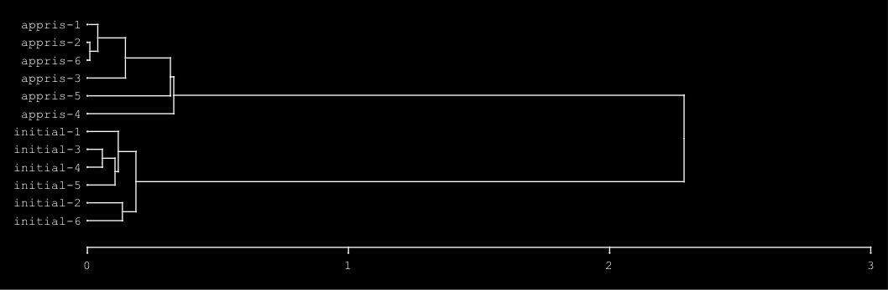

# Comparer des réseaux de neurones

[Exemples](../exemples.md) · In English: [Comparing neural networks](../examples/neuromuse-comparaison.md)

Plusieurs réseaux de [neuromuse](https://github.com/FredVoisin/neuromuse)
apprennent la même chose à partir de tirages aléatoires différents :
apprennent-ils de la même façon ? Cet exemple les compare avec refrains,
avant et après l'apprentissage, à la suite de
[Arbres de réseaux de neurones](neuromuse.md). Le code est dans
[lisp/neuromuse-comparaison.lisp](../lisp/neuromuse-comparaison.lisp) ; les
résultats ci-dessous sont ceux de SBCL, avec les tirages du script.

Deux réseaux appris à partir de tirages différents ne numérotent pas leurs
neurones de la même façon : les neurones cachés d'un perceptron multicouche
peuvent être permutés sans rien changer à ce qu'il calcule, et deux cartes
auto-organisatrices placent les mêmes sons en des endroits différents. Les
comparer poids à poids, ou neurone à neurone, n'aurait donc pas de sens. On
les compare par ce qui ne dépend pas de cette numérotation.

## Six perceptrons multicouches appris sur le XOR

Six MLP (2 entrées, 4 neurones cachés, 1 sortie) partent de six tirages
différents ; tous apprennent le XOR (sorties 0,02, 0,98, 0,98, 0,01 à 0,02).

**La géométrie de la couche cachée.** Pour chaque réseau, les quatre entrées
du XOR donnent quatre vecteurs d'activation de la couche cachée ; leurs six
distances (`dist-euclidean`) décrivent la façon dont le réseau sépare les
entrées, quel que soit l'ordre de ses neurones. Les distances entre ces
géométries, pour les six réseaux avant et après l'apprentissage, donnent un
dendrogramme (`graph-dendrogram`, lien moyen ; `dendrogram>dot`) :



Les réseaux initiaux et les réseaux appris forment deux groupes nettement
séparés (2,29). Les réseaux appris se ressemblent beaucoup plus entre eux que
les réseaux initiaux : 1, 2 et 6 sont presque identiques (0,01 à 0,04), le
réseau 4 est le plus différent (0,33). Partis de tirages différents, ils
convergent vers une même façon de séparer les entrées.

**Le rôle des neurones cachés.** Le profil d'un neurone caché est son
activation pour chacune des quatre entrées, (0,0), (1,0), (0,1) et (1,1) :
1 s'il est franchement actif (plus de 0,8), 0 s'il est éteint (moins de 0,2),
`-` s'il est indécis. `histogram` compte ces profils sur les six réseaux :

- avant l'apprentissage, les 24 neurones sont indécis, `(- - - -)` ;
- après l'apprentissage, trois rôles reviennent dans chacun des six réseaux :
  le détecteur de (0,1), `(- 0 1 0)`, le détecteur de (1,0), `(- 1 0 0)`, et
  un neurone éteint pour les trois autres entrées, `(- 0 0 0)` ; le quatrième
  neurone détecte surtout l'entrée I1, `(- 0 1 1)`, dans trois réseaux.

Pour l'entrée (0,0), tous les neurones valent 0,5, appris ou non : les MLP de
neuromuse n'ont pas de biais, et la fonction logistique d'une somme nulle vaut
0,5. Le neurone éteint suggère que trois neurones cachés suffiraient.

## Trois cartes auto-organisatrices apprises sur le chant du pinson

Trois cartes de 12 × 12 neurones (celle de l'exemple `pinson_som.lisp` de
neuromuse) partent de trois tirages différents et apprennent les trois chants
du pinson. On les compare sur le premier chant, avant et après
l'apprentissage.

| Carte | Topologie (sur 143 arêtes) | Neurones gagnants | Entropie (bits) |
|---|---|---|---|
| 1 | 5 → 122 | 54 → 88 | 4,73 → 5,57 |
| 2 | 4 → 122 | 61 → 95 | 4,84 → 5,65 |
| 3 | 1 → 115 | 53 → 88 | 4,44 → 5,54 |

- **La topologie** : le nombre d'arêtes de l'arbre de recouvrement minimal
  des prototypes (`graph-span`) qui relient des voisins sur la grille. Avant
  l'apprentissage, les prototypes sont tirés au hasard et l'arbre ignore la
  grille ; après, les trois cartes préservent la topologie de l'espace des
  sons, à peu près au même degré.
- **L'usage de la carte** : les trois cartes apprises utilisent davantage de
  neurones pour le même chant, avec une entropie plus haute (`entropy`) :
  elles le décrivent plus finement.
- **La segmentation du chant.** Les suites de gagnants de deux cartes ne se
  comparent pas symbole à symbole, puisque leurs neurones sont numérotés
  différemment (`dist-edit` donne 0,92 à 0,96 entre les cartes apprises), et
  `dist-structure`, qui compare la structure de répétitions de deux suites
  indépendamment des symboles, ne les distingue pas non plus sur des suites
  aussi longues (0,90 à 0,93). On compare donc les instants où chaque carte
  change de gagnant : pour chaque trame, 1 si le gagnant change, 0 sinon. La
  distance de Hamming normalisée (`dist-hamming`) entre ces segmentations
  vaut 0,15 à 0,18 entre les cartes apprises, 0,28 à 0,36 entre les cartes
  initiales, et 0,49 entre deux segmentations indépendantes qui changeraient
  aussi souvent. Les trois cartes apprises découpent le chant aux mêmes
  instants : elles en ont appris la même articulation, même si elles en
  nomment différemment les sons.

## Le code

Le code est la documentation.
[lisp/neuromuse-comparaison.lisp](../lisp/neuromuse-comparaison.lisp) demande
les systèmes neuromuse et refrains ; il se charge depuis le dossier du dépôt,
affiche les résultats et écrit son image dans `doc/pictures/` :

```lisp
(load "doc/lisp/neuromuse-comparaison.lisp")
```

<!-- code: doc/lisp/neuromuse-comparaison.lisp -->
```lisp
;;;; neuromuse-comparaison.lisp
;;;;
;;;; Comparer avec refrains plusieurs réseaux de neurones de neuromuse qui
;;;; apprennent la même chose, à partir de tirages initiaux différents :
;;;; 1. six perceptrons multicouches (MLP) appris sur le XOR : la géométrie de leur
;;;;    couche cachée et le rôle de leurs neurones, avant et après l'apprentissage ;
;;;; 2. trois cartes auto-organisatrices (SOM) apprises sur le chant du pinson : leur
;;;;    topologie, leur usage de la carte et leur segmentation du chant, avant et
;;;;    après l'apprentissage.
;;;;
;;;; Deux réseaux appris à partir de tirages différents ne numérotent pas leurs
;;;; neurones de la même façon : les neurones cachés d'un MLP peuvent être permutés
;;;; sans rien changer, et deux cartes placent les mêmes sons en des endroits
;;;; différents. On les compare donc par ce qui ne dépend pas de cette numérotation.
;;;;
;;;; Demande les systèmes neuromuse (https://github.com/FredVoisin/neuromuse) et
;;;; refrains, trouvables par ASDF. (load "doc/lisp/neuromuse-comparaison.lisp")
;;;; affiche les résultats et écrit, dans doc/pictures/,
;;;; neuromuse-comparaison.dot/.png. L'apprentissage des trois cartes prend environ
;;;; une minute et demie.
;;;;
;;;; Copyright (C) 2026 Frédéric Voisin
;;;;
;;;; Ce fichier, exemple de la documentation de refrains, est placé sous licence
;;;; Creative Commons Attribution 4.0 International (CC BY 4.0), comme la
;;;; documentation : voir ../LICENSE ou https://creativecommons.org/licenses/by/4.0/
;;;;
;;;; SPDX-License-Identifier: CC-BY-4.0

(asdf:load-system :neuromuse)
(asdf:load-system :refrains)
(in-package :neuromuse)

;; le dossier des images : doc/pictures/, à côté du dossier de ce fichier (doc/lisp/)
(defparameter *pictures*
  (merge-pathnames "pictures/" (uiop:pathname-parent-directory-pathname
                                (uiop:pathname-directory-pathname *load-truename*))))

(defun picture (name) (namestring (merge-pathnames name *pictures*)))

;; chaque réseau part d'un tirage aléatoire différent, mais reproductible
(defun tirage (n)
  (setf *random-state* #+sbcl (sb-ext:seed-random-state n) #-sbcl (make-random-state t)))

;;; 1. Six MLP appris sur le XOR : 2 entrées, 4 neurones cachés, 1 sortie

(defparameter *xor-entrees* '((0 0) (1 0) (0 1) (1 1)))
(defparameter *xor-sorties* '((0) (1) (1) (0)))

(defun profil (net)
  "Les activations des neurones cachés de NET (les poids d'un MLP) pour chacune des
quatre entrées du XOR : quatre vecteurs, un par entrée."
  (mapcar (lambda (entree) (logistic (matrix-vector (first net) entree))) *xor-entrees*))

(defun geometrie (net)
  "Les six distances entre les quatre entrées du XOR dans l'espace de la couche cachée
de NET : la façon dont le réseau sépare les entrées, qui ne dépend pas de l'ordre de
ses neurones cachés."
  (mapcar #'third (refrains:dist-euclidean (profil net) nil)))

;; les états de chaque réseau, avant et après l'apprentissage : (nom poids)
(defparameter *etats*
  (loop for k from 1 to 6
        append (progn
                 (tirage k)
                 (let ((mlp (make-instance 'mlp :name 'xor :in-size 2 :hidden-size '(4) :out-size 1
                                                :last-error 1000 :net (init-mlp-net 2 1 4))))
                   (setf (learn-fact mlp) .5 (verbose mlp) nil)
                   (let ((initial (copy-tree (net mlp))))
                     (loop repeat 20000
                           do (loop for entree in *xor-entrees* for sortie in *xor-sorties*
                                    do (setf (input mlp) entree (goal mlp) sortie) (learn mlp)))
                     (format t "~&réseau ~D : ~{~,2F~^ ~}~%" k
                             (loop for entree in *xor-entrees*
                                   collect (progn (setf (input mlp) entree) (car (run-mlp mlp)))))
                     (list (list (format nil "initial-~D" k) initial)
                           (list (format nil "appris-~D" k) (copy-tree (net mlp)))))))))

;; la semi-matrice des distances entre les douze états, d'après leur géométrie, puis
;; leur dendrogramme (lien moyen)
(defparameter *distances-etats*
  (loop for (a . autres) on *etats*
        nconc (loop for b in autres
                    collect (list (first a) (first b)
                                  (refrains:dist-euclidean (geometrie (second a)) (geometrie (second b)))))))

(defparameter *dendrogramme-etats*
  (nth-value 1 (refrains:graph-dendrogram *distances-etats* :linkage :average)))

(format t "~&dendrogramme des réseaux : ~S~%" *dendrogramme-etats*)
(refrains:dendrogram>dot *dendrogramme-etats* (picture "neuromuse-comparaison.png") :invert t)

;; le rôle de chaque neurone caché : son profil d'activation sur les quatre entrées,
;; 1 s'il est franchement actif (plus de 0,8), 0 s'il est éteint (moins de 0,2), - s'il
;; est indécis ; les rôles sont comptés sur les six réseaux avec histogram
(defun role (net neurone)
  (mapcar (lambda (activations)
            (let ((a (nth neurone activations)))
              (cond ((> a 0.8) 1) ((< a 0.2) 0) (t '-))))
          (profil net)))

(dolist (etat '("initial" "appris"))
  (format t "~&rôles des neurones cachés, réseaux ~A : ~S~%" etat
          (refrains:histogram
           (loop for (nom net) in *etats*
                 when (search etat nom)
                   append (loop for neurone below 4 collect (role net neurone)))
           :test #'equal)))

;;; 2. Trois cartes apprises sur le chant du pinson : 12 x 12 neurones, 18 bandes

(let ((*standard-output* (make-broadcast-stream))
      (examples (asdf:system-relative-pathname :neuromuse "examples/")))
  (load (merge-pathnames "pinson_vecteurs.lisp" examples))
  (load (merge-pathnames "pinson_som.lisp" examples)))

(defun topologie (som)
  "Le nombre d'arêtes de l'arbre de recouvrement minimal des prototypes de SOM qui
relient des voisins sur la grille."
  (let ((grille (grid-neighbour-pairs som))
        (arbre (refrains:graph-span
                (refrains:dist-euclidean
                 (mapcar (lambda (neurone) (mapcar #'third (edges neurone))) (net som)) nil))))
    (count-if (lambda (e) (member (list (min (first e) (second e)) (max (first e) (second e)))
                                  grille :test #'equal))
              arbre)))

(defun gagnants (som chant)
  "La suite des neurones gagnants de SOM pour CHANT, sans les répétitions locales."
  (refrains:filt-repeat (winner-sequence chant som)))

(defun frontieres (som chant)
  "Pour chaque trame de CHANT après la première, 1 si le neurone gagnant change, 0 sinon :
la segmentation du chant par SOM, qui ne dépend pas de la numérotation de ses neurones."
  (let ((suite (winner-sequence chant som)))
    (mapcar (lambda (a b) (if (= a b) 0 1)) suite (cdr suite))))

(defun etat-carte (som chant)
  (let ((suite (gagnants som chant)))
    (list :topologie (topologie som) :neurones (length (remove-duplicates suite))
          :entropie (refrains:entropy suite) :frontieres (frontieres som chant) :suite suite)))

;; chaque carte : (état initial, état appris), pour le premier chant
(defparameter *cartes*
  (loop for k from 1 to 3
        collect (progn
                  (tirage (+ 20 k))
                  (let ((som (make-instance 'som :name 'carte :size 144 :input 18))
                        (chant (first *pinson-chants*)))
                    (setf (learn-fact som) .4 (radius som) 3 (temp som) 0.0 (net-temp som) 0.05)
                    (let ((initial (etat-carte som chant)))
                      (train-pinson-som :epochs 10 :net som)
                      (list initial (etat-carte som chant)))))))

(loop for (initial appris) in *cartes* for k from 1
      do (format t "~&carte ~D : topologie ~D -> ~D (sur 143), neurones ~D -> ~D, entropie ~,2F -> ~,2F~%"
                 k (getf initial :topologie) (getf appris :topologie)
                 (getf initial :neurones) (getf appris :neurones)
                 (getf initial :entropie) (getf appris :entropie)))

;; les suites de gagnants de deux cartes apprises ne se comparent pas symbole à symbole
;; (leurs neurones sont numérotés différemment), et dist-structure, qui compare leurs
;; structures de répétitions indépendamment des symboles, ne les distingue pas sur des
;; suites aussi longues
(flet ((paires (f)
         (loop for (a . autres) on *cartes*
               nconc (loop for b in autres
                           collect (funcall f (getf (second a) :suite) (getf (second b) :suite))))))
  (format t "~&cartes apprises, dist-edit : ~{~,2F~^ ~} ; dist-structure : ~{~,2F~^ ~}~%"
          (paires (lambda (a b) (refrains:dist-edit a b :norm t)))
          (paires #'refrains:dist-structure)))

;; les cartes découpent-elles le chant aux mêmes instants ? distance de Hamming
;; normalisée entre leurs frontières, deux à deux, avant et après l'apprentissage
(dolist (etat '(first second))
  (format t "~&segmentations des cartes (~A) : ~{~,2F~^ ~}~%"
          (if (eq etat 'first) "initiales" "apprises")
          (loop for (a . autres) on *cartes*
                nconc (loop for b in autres
                            collect (refrains:dist-hamming (getf (funcall etat a) :frontieres)
                                                           (getf (funcall etat b) :frontieres))))))

;; la distance attendue entre deux segmentations indépendantes, de même taux de
;; changement p : 2 p (1 - p)
(let* ((f (getf (second (first *cartes*)) :frontieres))
       (p (/ (count 1 f) (float (length f)))))
  (format t "~&deux segmentations indépendantes : ~,2F~%" (* 2 p (- 1 p))))
```
<!-- /code -->

---

Cette documentation est placée sous licence
[Creative Commons Attribution 4.0 International (CC BY 4.0)](../LICENSE).
