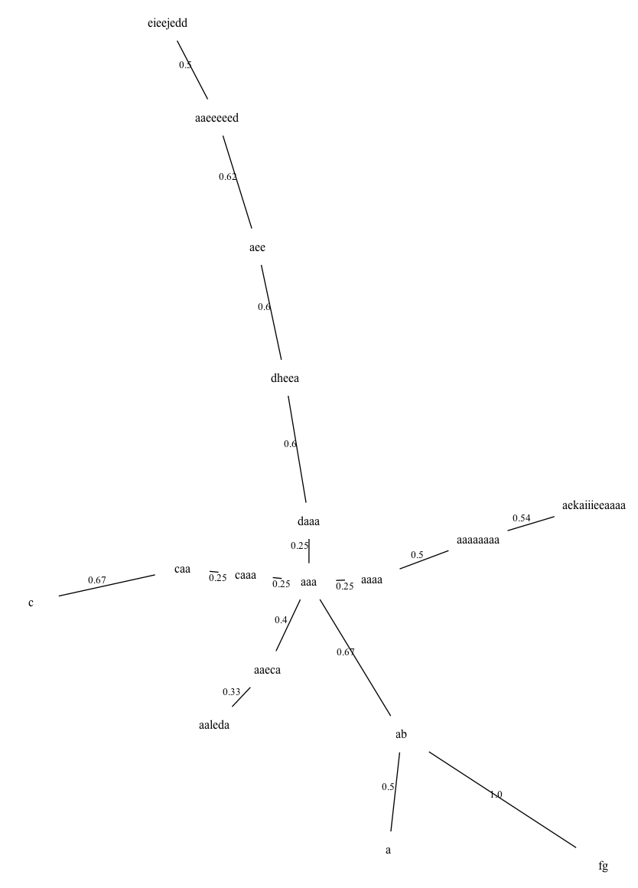
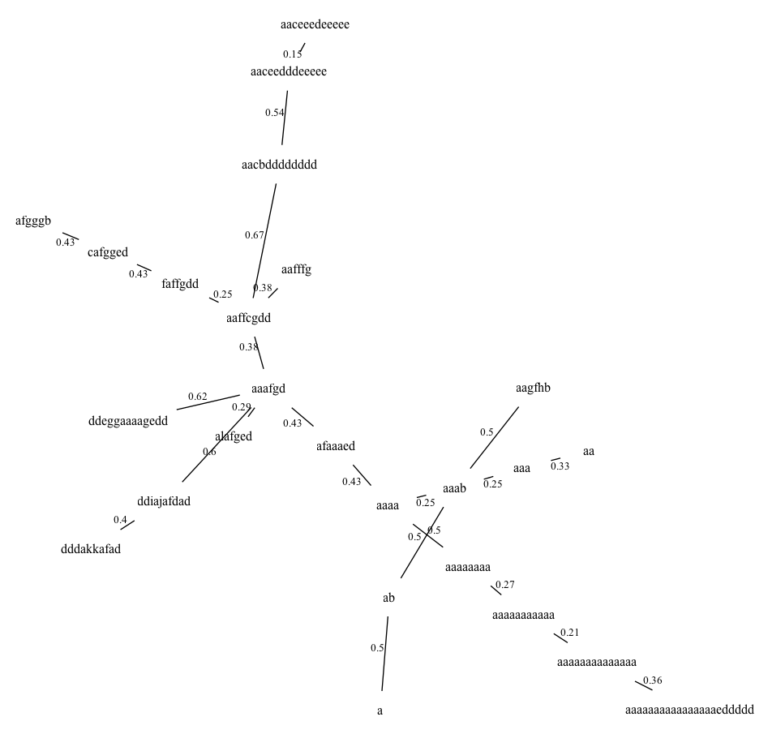
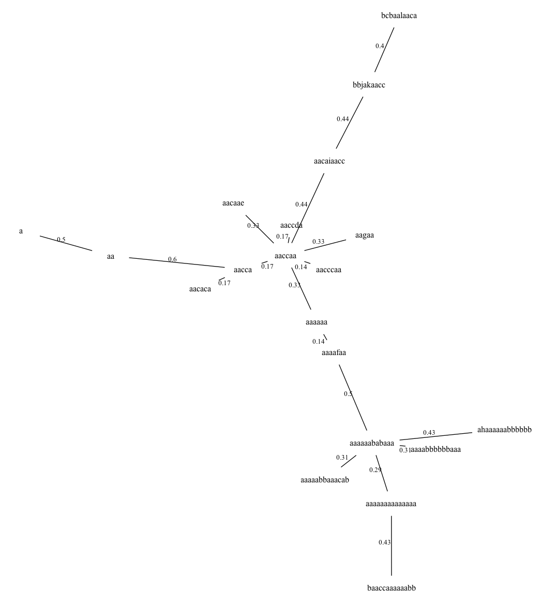
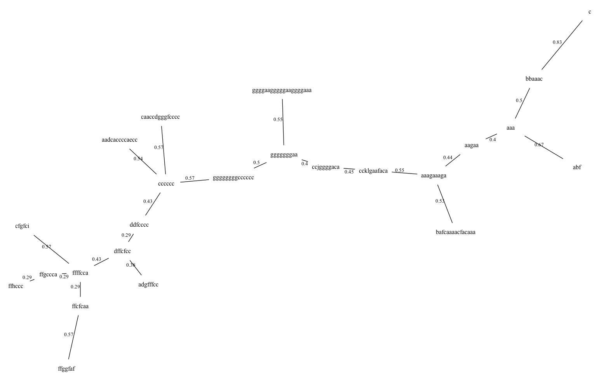
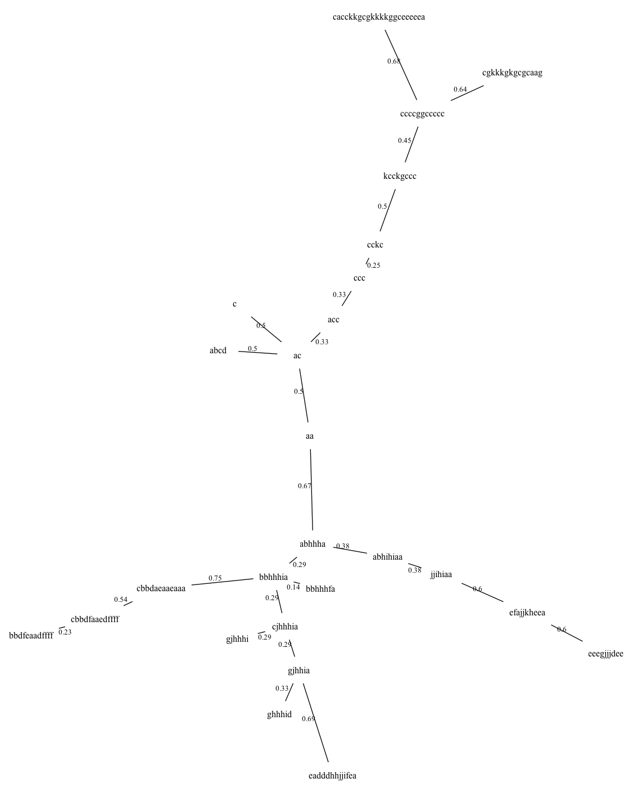
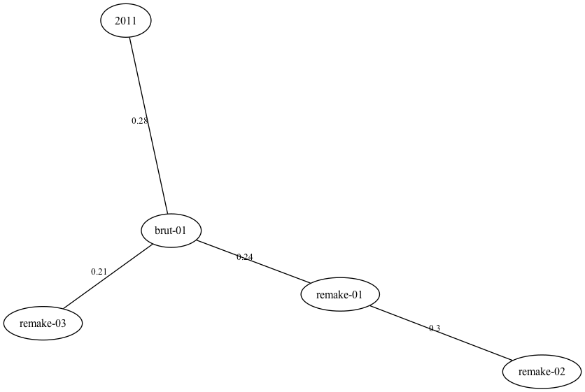

# Le chant du rougequeue noir : les arbres des transcriptions

[Exemples](../exemples.md)

F. Voisin, octobre 2026. Script : [lisp/rougequeue-noir-arbres.lisp](../lisp/rougequeue-noir-arbres.lisp).

Les exemples précédents transcrivent le chant du rougequeue noir en une suite
de lettres, une par spectre instantané :

- **2011** : l'exemple de 2011 ([rougequeue noir](rougequeue-noir.md)), depuis
  l'image du sonagramme convertie en texte par jp2a (300 spectres de 17 ms) ;
- **remake-01, remake-02, remake-03** : le remake de 2026 ([depuis Sonic
  Visualiser](rougequeue-noir-sv.md)), sur trois chants (spectres de 11,6 ms) ;
- **brut-01** : l'extension aux données brutes ([six niveaux
  d'intensité](rougequeue-noir-sv-niveaux.md)), sur le premier chant.

Cet exemple dessine l'arbre de recouvrement minimal de chaque transcription,
puis compare les arbres entre eux. Chaque transcription est classée seule : une
même lettre ne désigne pas le même type de spectre d'une transcription à
l'autre. Les arbres sont donc comparés par leur **forme**, qui ne dépend pas des
lettres.

## 1. Les transcriptions

`-` pour le silence, une lettre par classe de spectres :

```
2011
-----------------------ab-------aaa-aaa---aaaaaaaa--aaaaaaaa--caa--aaa--daaa--aaaa---aaa------caa------------c----------aee-----a--------aaeeeeed----fg-------dheea-eieejedd--aekaiiieeaaaa----aaaaaaaa--aaleda---aaeca---caaa----aaa----aaa----------------------------------------------------------------

remake-01
-----------ab---------------aaab----------aacbdddddddd----aaceedddeeeee----aaceeedeeeee---afgggb--aagfhb--aafffg---cafgged----faffgdd-------aaafgd------------------a-----------------aaa-aa-----aaa-------------aaaaaaaaaaa------aaaa-----------aaaaaaaa-aaaaaaaaaaaaaa-aaaaaaaaaaaaaaaaeddddd-----ddeggaaaagedd----ddiajafdad--dddakkafad----afaaaed----alafged----aaffcgdd-----------------------------------

remake-02
---------------------------aa-----------aaaaaababaaa----aaaabbbbbbaaa----aaaaabbaaacab--aaccaa--aaccda--aacccaa---aacaca----aacaae------aacca----------------------------------------aa---------------------------------------a-----------a------aaaafaa--------aagaa-a--aaaaaa-aaaaaaaaaaaaaa---ahaaaaaabbbbbb-----baaccaaaaaabb----aacaiaacc---bbjakaacc------bcbaalaaca------------------------------------------

remake-03
---------------------aaa-------------bbaaac-cccccc----aadcaccccaecc---bafcaaaacfacaaa-ffffcca-ffcfcaa-ffgccca--ffhccc---dffcfcc----cfgfci------------------abf-----------c---ffggfaf--c-----c------------aaagaaaga--gggggggaa---aagaa----ggggaagggggaaggggaaa-ggggggggcccccc-----caaccdgggfcccc---ccjggggaca--ccklgaafaca--adgfffcc-----ddfcccc------------------

brut-01
-----------aa---------------abcd----------cbbdaeaaeaaa----cbbdfaaedffff----bbdfeaadffff---ghhhid--gjhhia--gjhhhi---cjhhhia----jjihiaa-------abhhha------------------c-----------------ccc-ac-----acc-------------ccccggccccc------cckc-----------kcckgccc-cgkkkgkgcgcaag-cacckkgcgkkkkggceeeeea-----eadddhhjjifea----efajjkheea--eeegjjjdee----bbhhhia----bbhhhfa----abhihiaa-----------------------------------
```

## 2. Les arbres des transcriptions

Chaque transcription est coupée aux silences : une **note** est une suite de
lettres entre deux silences (`aacbdddddddd`, `afgggb`…). Les notes distinctes
sont les nœuds de l'arbre. Elles sont reliées par leur distance d'édition
normalisée (`dist-edit` avec `:norm t`), divisée par la longueur de la plus
longue des deux notes : de 0 (la même note) à 1 (toutes les lettres à
changer), quelle que soit la longueur des notes. Puis
`graph-span` en garde l'arbre de recouvrement minimal, et `graph>dot` le
dessine.

| Transcription | Notes | Distinctes | Longueur de l'arbre |
|---|---|---|---|
| 2011 | 25 | 17 | 7,93 |
| remake-01 | 26 | 25 | 9,67 |
| remake-02 | 23 | 20 | 6,43 |
| remake-03 | 26 | 24 | 11,04 |
| brut-01 | 26 | 26 | 11,15 |

### 2011



### remake-01



### remake-02



### remake-03



### brut-01



Dans chaque arbre, les notes d'une même phrase se suivent. Dans remake-01,
par exemple, les notes longues du début (`aacbdddddddd`, `aaceedddeeeee`,
`aaceeedeeeee`) forment une branche, les notes brèves (`afgggb`, `cafgged`,
`faffgdd`) une autre, et les notes faites de la seule classe `a` (`aaaa`,
`aaaaaaaa`, `aaaaaaaaaaa`…) une troisième.

## 3. La distance entre les arbres

La forme d'un arbre est décrite par des mesures qui ne dépendent pas des
lettres :

- les **déciles des longueurs de ses arêtes** : comment ses notes s'écartent
  les unes des autres ;
- la **proportion de ses nœuds de degré 1** (les feuilles), **2**, **3** et
  **4 ou plus** (`graph-degree`) : un arbre en chaîne a surtout des nœuds de
  degré 2, un arbre en étoile beaucoup de feuilles autour de quelques nœuds de
  degré élevé.

| Arbre | Déciles des longueurs (10 % à 90 %) | Degré 1 | 2 | 3 | 4+ |
|---|---|---|---|---|---|
| 2011 | 0,25 0,25 0,33 0,50 0,50 0,54 0,60 0,62 0,67 | 0,35 | 0,53 | 0,06 | 0,06 |
| remake-01 | 0,25 0,25 0,29 0,38 0,40 0,43 0,50 0,50 0,54 | 0,40 | 0,44 | 0,04 | 0,12 |
| remake-02 | 0,14 0,17 0,29 0,31 0,33 0,33 0,43 0,44 0,50 | 0,55 | 0,30 | 0,05 | 0,10 |
| remake-03 | 0,29 0,38 0,40 0,43 0,50 0,53 0,55 0,57 0,57 | 0,42 | 0,33 | 0,17 | 0,08 |
| brut-01 | 0,25 0,29 0,33 0,33 0,45 0,50 0,50 0,60 0,67 | 0,38 | 0,38 | 0,15 | 0,08 |

La distance entre deux arbres est la distance euclidienne entre ces deux
listes de 13 mesures (`dist-euclidean`) :

| | remake-01 | remake-02 | remake-03 | brut-01 |
|---|---|---|---|---|
| 2011 | 0,31 | 0,56 | 0,31 | 0,28 |
| remake-01 | | 0,30 | 0,30 | 0,24 |
| remake-02 | | | 0,48 | 0,42 |
| remake-03 | | | | 0,21 |

L'arbre résultant est l'arbre de recouvrement minimal de ces distances
(`graph-span`) :



- **brut-01 est au centre** : son arbre est le plus proche de ceux de
  remake-03 (0,21), de remake-01 (0,24) et de 2011 (0,28).
- **remake-02 est à l'écart** (0,30 de remake-01, 0,56 de 2011) : ses notes
  sont plus proches les unes des autres (des arêtes plus courtes), et son arbre
  a plus de feuilles (55 % des nœuds). La classe `a` domine sa transcription,
  et beaucoup de ses notes n'en diffèrent que par une ou deux lettres.
- **remake-01 et brut-01**, deux transcriptions du même chant, ont des arbres
  proches (0,24), bien que leurs lettres ne se correspondent pas. Mais
  remake-03, un autre chant, est encore plus proche de brut-01 (0,21) : la
  forme de l'arbre dépend autant de la méthode de transcription que du chant.

Ces distances restent des indications : chaque arbre n'a que 17 à 26 nœuds, et
ses déciles reposent sur 16 à 25 arêtes. Le choix des mesures de forme est
aussi un choix d'analyse, qu'on pourrait changer (le diamètre de l'arbre, sa
longueur totale, la distribution complète des degrés).

## Le code

Le code est la documentation. [lisp/rougequeue-noir-arbres.lisp](../lisp/rougequeue-noir-arbres.lisp)
se charge depuis le dossier du dépôt ; il charge lui-même les scripts des deux
exemples de 2026 pour en obtenir les transcriptions, et dessine les arbres avec
`neato` ([Graphviz](https://graphviz.org/)) :

```lisp
(load "doc/lisp/rougequeue-noir-arbres.lisp")
```

<!-- code: doc/lisp/rougequeue-noir-arbres.lisp -->
```lisp
;;;; rougequeue-noir-arbres.lisp
;;;;
;;;; Les arbres de recouvrement minimal des transcriptions du chant du rougequeue noir, et
;;;; l'arbre de leurs ressemblances. Cinq transcriptions : celle de 2011
;;;; (doc/exemples/rougequeue-noir.md), celles des trois chants du remake de 2026
;;;; (doc/lisp/rougequeue-noir-sv.lisp), et celle du premier chant en six niveaux
;;;; (doc/lisp/rougequeue-noir-sv-niveaux.lisp).
;;;;
;;;; Chaque transcription est coupée aux silences : chaque note est une suite de lettres
;;;; (une lettre par spectre). Les notes distinctes d'une transcription sont reliées par leur
;;;; distance d'édition normalisée (graph-span) : c'est l'arbre de la transcription. Les
;;;; lettres ne désignent pas les mêmes types de spectres d'une transcription à l'autre
;;;; (chacune est classée seule) : les arbres sont donc comparés par leur forme, qui ne
;;;; dépend pas des lettres, et les distances entre les formes donnent l'arbre résultant.
;;;;
;;;; (load "doc/lisp/rougequeue-noir-arbres.lisp") affiche les transcriptions, leurs arbres
;;;; et les distances entre les arbres, et dessine les arbres avec neato (Graphviz) :
;;;; doc/pictures/rougequeue-noir-arbre-*.png.
;;;;
;;;; Copyright (C) 2026 Frédéric Voisin
;;;;
;;;; Ce fichier, exemple de la documentation de refrains, est placé sous licence
;;;; Creative Commons Attribution 4.0 International (CC BY 4.0), comme la
;;;; documentation : voir ../LICENSE ou https://creativecommons.org/licenses/by/4.0/
;;;;
;;;; SPDX-License-Identifier: CC-BY-4.0

(asdf:load-system :refrains)
(in-package :refrains)

(defparameter *ici* (uiop:pathname-directory-pathname *load-truename*))
(defparameter *doc-arbres* (uiop:pathname-parent-directory-pathname *ici*))

;;; 1. Les transcriptions : une classe par spectre, 0 pour le silence

;; la transcription de 2011, depuis le texte de jp2a, comme dans rougequeue-noir.md
(defun transcription-2011 ()
  (let ((spectres (read-text (merge-pathnames "data/rougequeue_noir.txt" *doc-arbres*)
                             :mode :charcode :columns t)))
    (class-sym spectres 12 :edit-nn :ins 1.5 :del 1.5
               :excluded (list (make-list 45 :initial-element (char-code #\x))))))

;; une transcription d'un autre exemple : charger son script et appeler son analyse, sans
;; afficher ses résultats. Les deux scripts définissent tous deux analyse : chacun est chargé
;; juste avant de servir.
(defun transcription (script fichier)
  (let ((*standard-output* (make-broadcast-stream)))
    (load (merge-pathnames script *ici*))
    (funcall 'analyse (merge-pathnames fichier *doc-arbres*))))

(defparameter *transcriptions*
  (list (list "2011" (transcription-2011))
        (list "remake-01" (transcription "rougequeue-noir-sv.lisp" "data/rougequeue-noir01.csv"))
        (list "remake-02" (transcription "rougequeue-noir-sv.lisp" "data/rougequeue-noir02.csv"))
        (list "remake-03" (transcription "rougequeue-noir-sv.lisp" "data/rougequeue-noir03.csv"))
        (list "brut-01" (transcription "rougequeue-noir-sv-niveaux.lisp" "data/rougequeue-noir01.csv"))))

(defun lettre (c) (if (zerop c) "-" (string-downcase (num>alpha (1- c)))))

;;; 2. Les notes : les suites de lettres entre deux silences

(defun notes (classes)
  (let ((notes nil) (note nil))
    (dolist (c (append classes (list 0)) (nreverse notes))
      (cond ((plusp c) (push (lettre c) note))
            (note (push (apply #'concatenate 'string (reverse note)) notes)
                  (setf note nil))))))

;;; 3. L'arbre d'une transcription : les notes distinctes, reliées par leur distance
;;; d'édition normalisée (de 0 à 1, quelle que soit la longueur des notes)

(defun arbre (notes)
  (let ((distinctes (remove-duplicates notes :test #'string= :from-end t)))
    ;; dist-edit donne la semi-matrice (i j distance) ; les nœuds de l'arbre sont les notes
    (mapcar (lambda (e) (list (nth (first e) distinctes) (nth (second e) distinctes)
                              (/ (round (* 100 (third e))) 100.0)))
            (graph-span (dist-edit distinctes nil :norm t)))))

;;; 4. La forme d'un arbre, qui ne dépend pas des lettres : les déciles des longueurs de ses
;;; arêtes, et la proportion de ses nœuds de degré 1 (les feuilles), 2, 3 et 4 ou plus

(defun forme (arbre)
  (let* ((longueurs (sort (mapcar #'third arbre) #'<))
         (n (length longueurs))
         (degres (mapcar (lambda (x) (graph-degree x arbre)) (graph-nodes arbre))))
    (append (loop for q from 1 to 9 collect (nth (floor (* q (1- n)) 10) longueurs))
            (loop for d from 1 to 4
                  collect (/ (count-if (lambda (k) (if (= d 4) (>= k 4) (= k d))) degres)
                             (float (length degres)))))))

;;; 5. L'affichage et les dessins

(format t "~&~%1. Les transcriptions (- pour le silence, une lettre par classe)~%")
(loop for (nom classes) in *transcriptions*
      do (format t "~&~%~A (~D spectres)~%~{~A~}~%" nom (length classes) (mapcar #'lettre classes)))

(defparameter *arbres*
  (loop for (nom classes) in *transcriptions*
        collect (list nom (arbre (notes classes)))))

(format t "~&~%2. Les arbres des transcriptions~%")
(loop for (nom a) in *arbres*
      for notes = (notes (second (assoc nom *transcriptions* :test #'string=)))
      do (format t "~&~%~A : ~D notes, ~D distinctes ; longueur ~,2F~%" nom (length notes)
                 (length (graph-nodes a)) (graph-length a))
         (dolist (e a) (format t "~&  ~A — ~A  ~,2F~%" (first e) (second e) (third e)))
         (graph>dot a :out (merge-pathnames (format nil "pictures/rougequeue-noir-arbre-~A.png" nom)
                                             *doc-arbres*)
                      :shape "plaintext" :overlap nil))

(format t "~&~%3. La forme des arbres (déciles des longueurs, puis degrés 1, 2, 3, 4+)~%")
(defparameter *formes* (mapcar (lambda (x) (forme (second x))) *arbres*))
(loop for (nom) in *arbres* for f in *formes*
      do (format t "~&  ~10A ~{~,2F~^ ~}~%" nom f))

(format t "~&~%4. Les distances entre les arbres, et l'arbre résultant~%")
(defparameter *noms* (mapcar #'first *arbres*))
(defparameter *distances*
  (mapcar (lambda (e) (list (nth (first e) *noms*) (nth (second e) *noms*)
                            (/ (round (* 100 (third e))) 100.0)))
          (dist-euclidean *formes* nil)))
(dolist (e *distances*) (format t "~&  ~10A ~10A ~,2F~%" (first e) (second e) (third e)))
(defparameter *arbre-resultant* (graph-span *distances*))
(format t "~&~%Arbre résultant :~%")
(dolist (e *arbre-resultant*) (format t "~&  ~A — ~A  ~,2F~%" (first e) (second e) (third e)))
(graph>dot *arbre-resultant* :out (merge-pathnames "pictures/rougequeue-noir-arbres.png" *doc-arbres*)
                             :overlap nil)
```
<!-- /code -->

---

Cette documentation est placée sous licence
[Creative Commons Attribution 4.0 International (CC BY 4.0)](../LICENSE).
