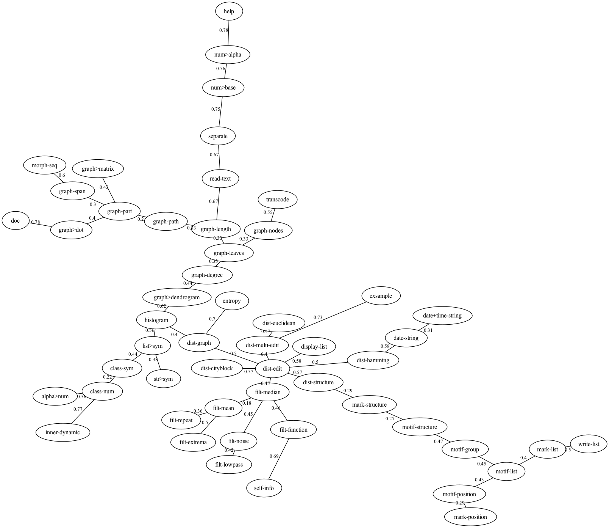
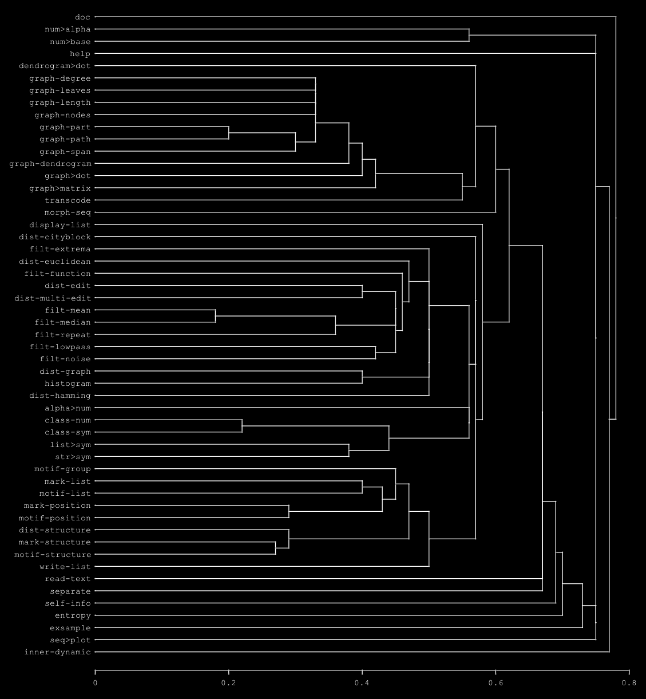
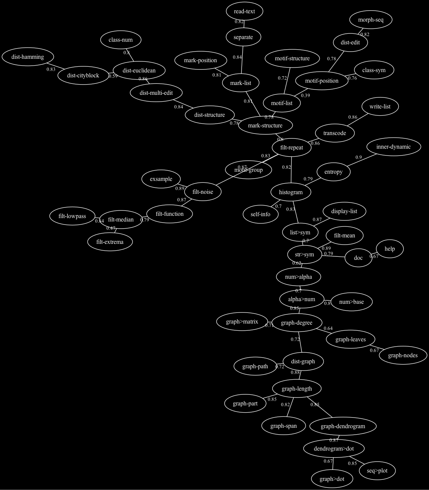
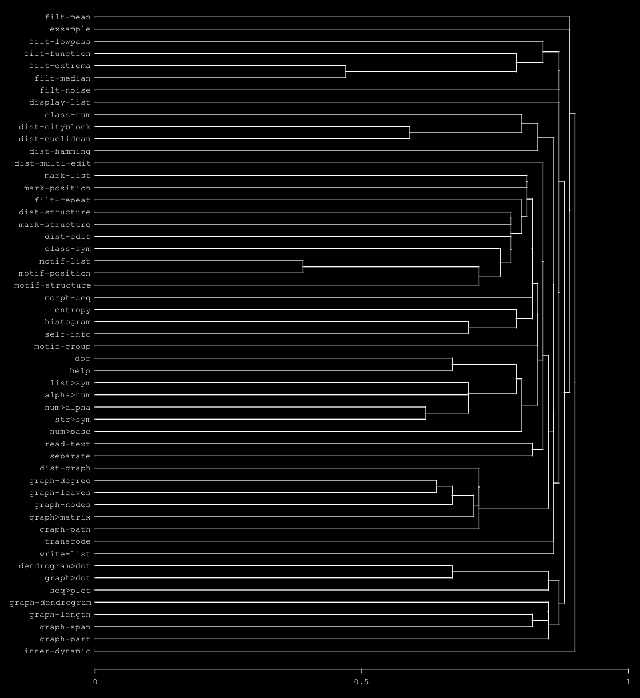

# refrains : fonctions et documentation

In English, see: [refrains-functions.md](refrains-functions.md)

Les 53 fonctions exportées du paquet `:refrains` (version 0.2.1), regroupées selon les sections du menu, avec leurs arguments et leur docstring en français (dans le code, les docstrings, affichées par `doc` et `help`, sont en anglais). Le nom de chaque fonction renvoie à sa description dans la [documentation](refrains.fr.md) quand elle y figure. Cette liste est la version de référence.

Les ressemblances entre ces fonctions, d'après leurs noms et d'après leur documentation, sont tracées dans les [Arbres des fonctions](#arbres-des-fonctions).

A propos de terminologie : dans un souci de simplification et de cohérence, le nom des fonctions peut évoluer avec les versions et, autant que possible, se référer à une étymologie commune au français et à l'anglais (voire à l'indo-européen !). Depuis la version 0.2.0, les noms suivent deux conventions : `famille-objet` (`filt-median`, `graph-path`, `dist-edit`, `motif-list`…) et `source>cible` pour les conversions (`num>base`, `str>sym`, `graph>dot`, `dendrogram>dot`…). Le signe `>` marque un changement de représentation, sans analyse : le même contenu sous une autre forme (un nombre en base n, une liste en symbole, un graphe en matrice ou en fichier dot). Le tiret marque une opération d'une famille, qui calcule quelque chose de nouveau : filtrer, mesurer une distance, chercher des motifs, classer (`graph-span`, `graph-part`, `graph-dendrogram`). Le signe `>` se lit « vers » comme « to » : il ne dépend d'aucune langue. Pour les fonctions qui portent sur des arbres, on a préféré *graph* à *arbre* : le mot est commun au français et à l'anglais (*graphe*, *graph*), la théorie des graphes s'applique aux arbres, et elle sert aussi au développement de refrains.

## 1. Transcription

| Fonction | Arguments | Documentation |
|---|---|---|
| [`transcode`](refrains.fr.md#transcode-seq-table-optional-test) | `seq table &optional test` | TRANSCODE : remplace chaque élément de &lt;seq&gt; au moyen d'une liste (table) de changements &lt;table&gt; de la forme '((ancien nouveau) ...). Par défaut, le test est #'eq. |
| [`num>base`](refrains.fr.md#numbase-num-base) | `num base` | NUM&gt;BASE : convertit un nombre en sa représentation en base &lt;base&gt;. |
| [`num>alpha`](refrains.fr.md#numalpha-num) | `num` | Convertit des listes de listes et/ou des entiers en symboles : 0 -&gt; A, 1 -&gt; B, 2 -&gt; C, 26 -&gt; AA, etc. |
| [`alpha>num`](refrains.fr.md#alphanum-char-optional-mode) | `char &optional mode` | Convertit des caractères ou des listes de caractères en nombres : 'a' en 0, 'b' en 1, etc. Différents modes peuvent être choisis avec l'option `mode`. |
| [`list>sym`](refrains.fr.md#listsym-list) | `list` | LIST&gt;SYM : concatène les éléments de &lt;list&gt; en un seul élément : des nombres en un nombre, des chaînes en une chaîne, les autres éléments en un symbole. |
| [`str>sym`](refrains.fr.md#strsym-strings) | `strings` | Convertit une chaîne ou une liste de chaînes en, respectivement, une liste ou une liste de listes de symboles. |
| [`filt-median`](refrains.fr.md#filt-median-seq-window) | `seq window` | FILT-MEDIAN : filtre médian sur une fenêtre de &lt;window&gt; valeurs et centrée sur chaque valeur de &lt;seq&gt; (une fenêtre paire est élargie à la taille impaire supérieure, pour que le résultat soit formé de valeurs de &lt;seq&gt;) ; la première et la dernière valeur sont répétées aux bords. Le résultat a la même longueur que &lt;seq&gt;. |
| [`filt-extrema`](refrains.fr.md#filt-extrema-seq-window-optional-mode) | `seq window &optional mode` | FILT-EXTREMA : maximum (&lt;mode&gt; :max, par défaut) ou minimum (:min) sur une fenêtre de &lt;window&gt; valeurs centrée sur chaque valeur de &lt;seq&gt;, au contraire du filtre médian : les pics (ou les creux) sont élargis. :open (minimum puis maximum) supprime les pics plus étroits que la fenêtre, :close (maximum puis minimum) comble les creux plus étroits que la fenêtre, en conservant en place les autres valeurs. Une fenêtre paire est élargie à la taille impaire suivante ; la première et la dernière valeur sont répétées aux bords. Le résultat a la même longueur que &lt;seq&gt;. |
| [`filt-mean`](refrains.fr.md#filt-mean-seq-window-optional-step) | `seq window &optional step` | Remplace chaque valeur par sa moyenne sur une fenêtre glissante. |
| [`filt-lowpass`](refrains.fr.md#filt-lowpass-seq-alpha-optional-gamma) | `seq alpha &optional gamma` | FILT-LOWPASS : lissage exponentiel de &lt;seq&gt; : chaque valeur se rapproche de l'entrée de la fraction &lt;alpha&gt; (de 0 à 1), s(t) = s(t-1) + alpha (x(t) - s(t-1)). Avec &lt;gamma&gt; (de 0 à 1), lissage exponentiel double (Holt), qui suit aussi la tendance de &lt;seq&gt;. Le résultat a la même longueur que &lt;seq&gt;. |
| [`filt-repeat`](refrains.fr.md#filt-repeat-seq-optional-mode-test) | `seq &optional mode test` | FILT-REPEAT : supprime les éléments identiques consécutifs de &lt;seq&gt; (&lt;mode&gt; nil ou :delete) ou, pour des nombres, remplace chaque suite de valeurs identiques par une rampe vers la valeur différente suivante (&lt;mode&gt; :linear, ou :interp), en gardant la longueur de &lt;seq&gt;. &lt;test&gt; : identité des éléments (equalp par défaut). |
| [`filt-noise`](refrains.fr.md#filt-noise-seq-optional-mode-val) | `seq &optional mode val` | FILT-NOISE : agite ou bruite la suite &lt;seq&gt; selon différentes méthodes, choisies par le premier argument optionnel &lt;mode&gt;, avec la quantité &lt;val&gt; (0.1 par défaut), relative à l'étendue (max - min) de &lt;seq&gt; :  :nozero : remplace chaque valeur nulle de &lt;seq&gt; par une valeur aléatoire dans ]0, val * étendue[  :swap : échange val * longueur paires d'éléments (val entier : le nombre d'échanges)  :relative : ajoute à chaque valeur une quantité aléatoire dans [-val * étendue, val * étendue] Les éléments d'une suite non numérique sont échangés. &lt;mode&gt; peut aussi être une fonction de deux arguments (x l) : chaque élément x de &lt;seq&gt; est remplacé par son résultat, l étant toute la suite &lt;seq&gt; ; &lt;val&gt; est alors ignoré. Par exemple, (lambda (x l) (declare (ignore x)) (nth (random (length l)) l)) remplace chaque élément par un élément de &lt;seq&gt; pris au hasard. |
| [`filt-function`](refrains.fr.md#filt-function-seq-func-window-optional-step) | `seq func window &optional step` | Applique la fonction &lt;func&gt; à la suite &lt;seq&gt; sur une fenêtre glissante de longueur &lt;window&gt;, avec le pas (optionnel) &lt;step&gt; (1 par défaut). La taille de la fenêtre peut être un entier (en échantillons) ou une fraction de la longueur de seq ; le pas peut être un entier (en échantillons) ou une fraction de la fenêtre. Avec un pas de 1, la fenêtre est centrée sur chaque valeur ; avec un pas plus grand, elle est centrée sur chaque bloc de step valeurs. Une valeur renvoyée par &lt;func&gt; est répétée pour le bloc ; une liste remplace le bloc (step = window), ou donne les valeurs des positions du bloc. |
| [`graph-span`](refrains.fr.md#graph-span-mat-dist-optional-verbose) | `mat-dist &optional verbose` | GRAPH-SPAN : arbre de recouvrement minimal construit sur une semi-matrice de distances &lt;mat-dist&gt;. |
| [`graph-dendrogram`](refrains.fr.md#graph-dendrogram-mat-dist-key-linkage) | `mat-dist &key linkage` | GRAPH-DENDROGRAM : dendrogramme de la classification hiérarchique des objets d'une semi-matrice de distances ou d'un graphe &lt;mat-dist&gt;, une liste d'arêtes (nœud-a nœud-b distance). Renvoie deux valeurs : la liste des fusions successives (distance groupe-a groupe-b), par distance croissante, où un groupe est la liste de ses nœuds ; et le dendrogramme, où chaque fusion est (distance arbre-a arbre-b) et dont les feuilles sont les objets. :linkage définit la distance entre deux groupes : :single (par défaut) la plus petite distance entre leurs objets, donnée par l'arbre de recouvrement minimal (voir graph-span ; un graphe non connexe donne la liste des dendrogrammes de ses parties) ; :complete la plus grande distance ; :average (UPGMA) la distance moyenne ; :ward (méthode de Ward) la fusion qui augmente le moins l'inertie intra-classe, sa distance étant la racine carrée du double de cette augmentation (la distance elle-même pour deux objets). :complete, :average et :ward demandent une semi-matrice de distances complète ; :ward suppose des distances euclidiennes. |
| [`graph>matrix`](refrains.fr.md#graphmatrix-graph) | `graph` | GRAPH&gt;MATRIX : matrice d'adjacence symétrique de &lt;graph&gt;, une liste d'arêtes (nœud-a nœud-b distance), sous forme de liste de lignes : lignes et colonnes dans l'ordre de graph-nodes, la distance de chaque arête, 0 ailleurs. |
| [`morph-seq`](refrains.fr.md#morph-seq-seq1-seq2-key-test-random) | `seq1 seq2 &key test random` | MORPH-SEQ : interpole la suite &lt;seq1&gt; vers la suite &lt;seq2&gt; en un minimum d'étapes, en changeant un élément à la fois (substitution, suppression ou insertion) le long d'un chemin d'édition de coût minimal (voir dist-edit) : la liste des suites de &lt;seq1&gt; à &lt;seq2&gt;, autant d'étapes que leur distance d'édition. &lt;test&gt; : identité des éléments (equalp par défaut). À coûts égaux, la substitution est préférée, puis la suppression, puis l'insertion ; avec :random t, l'une d'elles au hasard. Deux chaînes donnent des chaînes. |

## 2. Classification

| Fonction | Arguments | Documentation |
|---|---|---|
| [`exsample`](refrains.fr.md#exsample-seq-method-thres-key-diff-duration-out) | `seq method thres &key diff duration out` | EXSAMPLE : échantillonne une suite de valeurs numériques &lt;seq&gt; selon sa signature, points saillants avec un seuil &lt;thres&gt; pour les variations d'intensité. L'argument &lt;thres&gt; peut être nil ou 0 (pas de seuil pour les variations d'intensité), ou une amplitude absolue (dans l'unité des valeurs de &lt;seq&gt;, non négative) : les variations inférieures à &lt;thres&gt; sont ignorées. L'argument &lt;method&gt; définit l'algorithme de calcul de la signature : :minflexmax (par défaut, ou nil) : renvoie les minima, les maxima et les inflexions (plateaux, variations négligeables) : les minima et maxima de :minmax, et une inflexion là où un plateau  qui n'est pas un extremum commence et là où il finit (un plateau est une portion d'au moins :duration positions où la suite varie de moins de thres) ; :minmax : minima et maxima seulement : les extrema importants de :major-extrema, avec \|a - b\| ; :major-extrema : extrema importants (Fink & Gandhi, Conference on Systems, Man and Cybernetics, 2007) :  un minimum (maximum) tel que la suite monte (descend) d'au moins thres des deux côtés ; :landmarks : points de repère du premier ordre lissés par MDPP(D, P) (Perng, Parker & Leung, Conference on Information  and Knowledge Management, 1999) : les paires de repères proches dont la différence est inférieure à thres sont supprimées. Le mot-clé :diff, avec :major-extrema et :landmarks, est la différence entre deux valeurs : :absolute (\|a - b\|, par défaut), :relative (2 \|a - b\| / (\|a\| + \|b\|), comme chez Perng et al.) ou une fonction (a b). Le mot-clé :duration, un nombre de positions : avec :minflexmax, la durée minimale d'un plateau (nil, 0, 1 et 2 valent 2) ; avec :landmarks, D (seuls les repères distants de moins de D positions peuvent être supprimés ; nil : aucune limite). Un mot-clé dont la méthode ne se sert pas est une erreur. Le mot-clé :out définit la sortie : :values (par défaut, ou nil), :positions, :all (position valeur) ou :resampled (les droites entre les points, à chaque position), toutes avec la première et la dernière valeur de &lt;seq&gt; ; ou :signature, les points (position type valeur), type -1 pour un minimum, 1 pour un maximum et 0 pour une inflexion, sans la première ni la dernière valeur. |
| [`separate`](refrains.fr.md#separate-seq-key-marks-keep) | `seq &key marks keep` | SEPARATE : sépare &lt;seq&gt; à ses marques, et renvoie la liste de ses segments. Une chaîne est séparée aux caractères de la chaîne :marks et aux blancs. Une liste est séparée aux éléments de la liste :marks (comparés avec equalp), à une marque unique, ou là où le prédicat :marks est vrai. Le mot-clé :keep, nil (par défaut) pour supprimer les marques, ou t pour les garder : chaque marque commence le segment qui la suit (les blancs sont toujours supprimés). Les segments vides sont supprimés. |
| [`motif-group`](refrains.fr.md#motif-group-seq-test-optional-key) | `seq test &optional key` | MOTIF-GROUP : regroupe les éléments ou motifs consécutifs de &lt;seq&gt; pour lesquels la comparaison &lt;test&gt; (equalp par défaut) réussit. L'argument optionnel &lt;key&gt; définit une fonction à appliquer à chaque élément ou motif consécutif à comparer. |
| [`mark-structure`](refrains.fr.md#mark-structure-seq-out-key-diss-rem-loc-dup-test) | `seq out &key diss rem-loc-dup test` | MARK-STRUCTURE : renvoie les structures possibles de &lt;seq&gt; données par ses marques : chaque marque ouvre des segments, et les répétitions de ces segments donnent une structure. Les structures sont triées par longueur. L'argument &lt;out&gt; définit la forme du résultat (une autre valeur est une erreur) : :struct (ou nil) : liste toutes les structures possibles selon les différentes marques de &lt;seq&gt; :pos : à chaque structure est associée la liste des positions de chaque segment, suivie de la liste des segments eux-mêmes :raw : à chaque structure est associée la liste des différents segments, chacun suivi de toutes ses positions dans &lt;seq&gt;. L'option :diss définit le seuil de dissemblance en dessous duquel des segments différents sont considérés comme identiques. L'option :test (equalp par défaut) définit l'identité des éléments : celle des marques, celle des éléments des segments comparés par la distance d'édition, et celle des éléments consécutifs supprimés par :rem-loc-dup. L'option :rem-loc-dup (t par défaut) supprime les répétitions locales à l'intérieur de chaque segment ; les positions se rapportent à &lt;seq&gt;. |
| [`motif-structure`](refrains.fr.md#motif-structure-seq-key-lengths-test-diss-l-var-criteria-distance) | `seq &key lengths test diss l-var criteria distance` | MOTIF-STRUCTURE : structure de &lt;seq&gt; en termes de motifs répétés, sous forme d'une liste de deux éléments : les positions où commencent des motifs, chacune suivie des numéros des motifs qui y commencent, puis les motifs. Un motif est un segment répété au moins une fois, plus loin et sans chevauchement. :lengths : les longueurs des motifs cherchés : (min max), ou un maximum k pour les longueurs 2 à k (par défaut : de 3 à la moitié de la longueur de &lt;seq&gt;) ; :test : l'identité des éléments (equalp par défaut) ; :diss : la tolérance, distance d'édition normalisée maximale (de 0 à 1) entre un motif et ses répétitions (0 par défaut : répétitions exactes) ; :l-var : la variation de longueur des répétitions, en fraction de la longueur du motif (0 par défaut ; utilisée avec une tolérance) ; :criteria : :length (par défaut) ou :freq, pour garder le plus long ou le plus fréquent des motifs contenus les uns dans les autres ; :distance : une fonction (a b) donnant la distance entre deux segments (des listes), à la place de la distance d'édition ; :diss est alors dans son unité. |
| [`class-num`](refrains.fr.md#class-num-data-classes-mode-key-iter-dist) | `data classes mode &key iter dist` | CLASS-NUM : classe les points &lt;data&gt; en &lt;classes&gt; classes, dans un espace à n dimensions (n entier &gt; 0) : chaque point est un nombre (une dimension) ou la liste de ses coordonnées. L'argument &lt;mode&gt; définit l'algorithme de partition des points : :centroids : algorithme des centres mobiles (nuées dynamiques) ; :1d-centroids : centres initiaux pris entre les plus grandes différences des données triées (une dimension, déterministe). Le mot-clé :iter fixe le nombre d'exécutions de l'algorithme (avec :centroids) ; :dist fixe la distance ou la métrique utilisée (par défaut : distance euclidienne). |
| [`class-sym`](refrains.fr.md#class-sym-data-classes-mode-key-sub-ins-del-uncom-excluded-mst) | `data classes mode &key sub ins del uncom excluded mst` | CLASS-SYM : classe un ensemble de segments ou de suites en différentes classes selon leurs distances d'édition mutuelles, en partitionnant l'arbre de recouvrement qui en résulte (voir graph-part). Le résultat est une liste de nombres (à partir de zéro), instances des différentes classes trouvées. Les mots-clés :sub :ins :del :uncom règlent la distance d'édition (voir dist-edit). L'argument :excluded est une liste d'éléments de data exclus de la classification ; dans le résultat, la numérotation des instances commence par ces éléments (à partir de zéro), dans l'ordre défini par l'argument :excluded. |
| [`graph-part`](refrains.fr.md#graph-part-graph-optional-mode-n) | `graph &optional mode n` | GRAPH-PART : partitionne un graphe selon ses arêtes de longueur maximale. Sans &lt;n&gt;, toutes les arêtes de longueur maximale sont coupées ; avec &lt;n&gt;, les n-1 arêtes les plus longues sont coupées, ce qui donne n parties. |

## 3. Évaluation

| Fonction | Arguments | Documentation |
|---|---|---|
| [`mark-position`](refrains.fr.md#mark-position-seq-mark-optional-test-cons) | `seq mark &optional test cons` | MARK-POSITION : renvoie toutes les positions des marques dans seq. |
| [`mark-list`](refrains.fr.md#mark-list-seq-mark-key-mark-test-seg-test) | `seq mark &key mark-test seg-test` | MARK-LIST : renvoie la liste de tous les segments de &lt;seq&gt; qui commencent par une des marques définies par l'argument &lt;mark&gt;, avec leur position. Sans marque (nil), considère tous les symboles différents de &lt;seq&gt;. L'option :mark-test définit la fonction de test pour chercher les marques (equalp par défaut). L'option :seg-test définit la fonction de test pour comparer les différents segments. |
| [`motif-position`](refrains.fr.md#motif-position-motif-seq-key-diss-l-var-sub-ins-del-uncom-test) | `motif seq &key diss l-var sub ins del uncom test` | MOTIF-POSITION : renvoie toutes les positions d'un motif &lt;motif&gt; dans une suite &lt;seq&gt;. L'argument :diss est le seuil (de 0 à 1.0) de dissemblance, selon la distance d'édition normalisée, en dessous duquel deux segments différents sont considérés comme identiques ; l'argument :l-var est le seuil de variation de longueur des motifs comparés ; les arguments :sub :ins :del :uncom et :test règlent la distance d'édition (voir dist-edit). |
| [`motif-list`](refrains.fr.md#motif-list-seq-out-key-diss-l-var-n-sub-ins-del-uncom-test) | `seq out &key diss l-var n sub ins del uncom test` | MOTIF-LIST : renvoie la liste de tous les motifs trouvés dans &lt;seq&gt;, un motif étant tout segment répété au moins une fois selon la distance d'édition. Le résultat peut être trié selon la longueur des segments (:length, ou nil) ou selon leur fréquence (:freq) ; une autre sortie est une erreur. L'argument :diss est un seuil (de 0 à 1.0) de dissemblance, selon la distance d'édition normalisée, en dessous duquel deux segments différents sont considérés comme identiques ; l'argument :l-var est le seuil de variation de longueur des segments comparés ; l'argument :n est la longueur maximale des motifs (longueurs 2 à n), ou une liste (min max) (par défaut : de 3 à la moitié de la longueur de &lt;seq&gt;) ; les arguments :sub :ins :del :uncom et :test règlent la distance d'édition (voir dist-edit). |
| [`graph-nodes`](refrains.fr.md#graph-nodes-graph-graph-leaves-graph) | `graph` | GRAPH-NODES : liste de tous les nœuds d'un graphe, chacun une seule fois, triés. |
| [`graph-leaves`](refrains.fr.md#graph-nodes-graph-graph-leaves-graph) | `graph` | GRAPH-LEAVES : renvoie toutes les extrémités (feuilles) d'un graphe, les nœuds de degré 1, triées comme par graph-nodes. |
| [`graph-degree`](refrains.fr.md#graph-degree-node-graph) | `node graph` | GRAPH-DEGREE : degré d'un nœud dans un graphe, le nombre de ses arêtes (0 s'il n'est pas dans le graphe). Une liste de nœuds donne la liste de leurs degrés, nil les degrés de tous les nœuds, dans l'ordre de graph-nodes. |
| [`graph-path`](refrains.fr.md#graph-path-from-to-graph) | `from to graph` | GRAPH-PATH : renvoie le ou les chemins d'un ou plusieurs nœuds ou feuilles vers un ou plusieurs autres nœuds ou feuilles d'un graphe ; dans un graphe avec des cycles, le plus court chemin selon les distances. |
| [`dist-euclidean`](refrains.fr.md#dist-euclidean-a-b) | `a b` | DIST-EUCLIDEAN : distance euclidienne entre les points a et b. Les coordonnées d'un point sont représentées par une liste de valeurs, dans un espace euclidien à n dimensions (n entier &gt; 0). La dimension de l'espace est définie par les listes qui représentent &lt;a&gt; et &lt;b&gt;.  Si a est une liste de coordonnées (de listes) et b nul, le résultat est la liste des distances de chaque point à tous les autres ;  si a ou b est un nombre, b ou a est considéré comme une liste de nombres (1 dimension). Si a et b sont des listes de tailles différentes (des points de dimensions différentes),  renvoie NIL (pas de distance). |
| [`dist-cityblock`](refrains.fr.md#dist-cityblock-a-b) | `a b` | DIST-CITYBLOCK : distance city-block (de Manhattan) entre &lt;x&gt; et &lt;y&gt;, qui représentent des « points » dans une sorte d'espace euclidien. Si &lt;y&gt; est nul, &lt;x&gt; peut représenter une liste de points ; le résultat est alors la liste des distances city-block de chaque point à tous les autres. |
| [`dist-hamming`](refrains.fr.md#dist-hamming-a-b-optional-norm-test) | `a b &optional norm test` | DIST-HAMMING : distance de Hamming entre la liste a et la liste b. |
| [`dist-edit`](refrains.fr.md#dist-edit-seq1-seq2-key-sub-ins-del-uncom-norm-test) | `seq1 seq2 &key sub ins del uncom norm test` | DIST-EDIT : distance d'édition de seq1 à seq2. Mots-clés : :sub : coût de substitution d'un symbole (1 par défaut) :ins : coût d'insertion d'un symbole (1 par défaut) :del : coût de suppression d'un symbole (1 par défaut) :uncom : coût de substitution des symboles qui ne sont pas communs aux deux suites :norm : résultat divisé par la longueur de la plus longue suite, de 0 à 1 avec des coûts de 1 (T, ou NIL par défaut) :test : fonction d'identité |
| [`dist-multi-edit`](refrains.fr.md#dist-multi-edit-seq1-seq2-wgth-key-sub-ins-del-uncom-test) | `seq1 seq2 wgth &key sub ins del uncom test` | DIST-MULTI-EDIT : distance d'édition entre seq1 et seq2, dont les éléments sont des listes de descripteurs (un par dimension), les distances des dimensions étant pondérées par wgth : un nombre (même poids pour toutes) ou une liste de poids, un par dimension (une liste trop courte est complétée par son dernier poids, une liste trop longue est coupée). Les poids sont normalisés pour que leur somme soit 1. |
| [`dist-structure`](refrains.fr.md#dist-structure-a-b-key-w-occ-w-rep-test) | `a b &key w-occ w-rep test` | DIST-STRUCTURE : dissemblance entre les suites &lt;a&gt; et &lt;b&gt; du point de vue de leur structure, de 0 (même structure) à 1 : pour chaque élément, son nombre d'occurrences et la position de sa première occurrence sont comparés par la distance d'édition. Expérimental. :w-occ, :w-rep : poids des occurrences et des répétitions ; :test : identité des éléments (equalp par défaut). Si &lt;b&gt; est nil, les distances entre toutes les suites de &lt;a&gt;. |
| [`dist-graph`](refrains.fr.md#dist-graph-v1-v2-graph) | `v1 v2 graph` | DIST-GRAPH : distance entre les nœuds &lt;v1&gt; et &lt;v2&gt; d'un graphe : la longueur du plus court chemin entre eux (algorithme de Dijkstra, voir graph-path), 0 d'un nœud à lui-même, nil s'il n'y a pas de chemin. Une liste de nœuds &lt;v2&gt; donne la liste de leurs distances à &lt;v1&gt;, et nil les distances de &lt;v1&gt; à tous les nœuds, dans l'ordre de graph-nodes. |
| [`histogram`](refrains.fr.md#histogram-data-key-test-thes) | `data &key test thes` | HISTOGRAM : histogramme des données, sous forme de liste de (élément effectif) : triée par valeur croissante pour des nombres, sinon par effectif décroissant (à effectif égal, dans l'ordre de première apparition). Arguments optionnels : test : test d'identité (equalp par défaut) thes : thésaurus, ou liste des symboles à considérer. |
| [`entropy`](refrains.fr.md#entropy-data-optional-mode-samples-test) | `data &optional mode samples test` | ENTROPY : entropie de l'ensemble ou de la suite &lt;data&gt;, selon &lt;mode&gt; (un symbole de n'importe quel paquet, un mot-clé ou une chaîne) : shannon-2 (ou nil, par défaut) : entropie de Shannon en base 2 ; shannon-n : entropie de Shannon en base n, le nombre d'éléments distincts (de 0 à 1) ; shannon-e : entropie de Shannon avec le logarithme naturel ; cond-sh : entropie conditionnelle (expérimental). &lt;samples&gt; : nombre de fenêtres consécutives de &lt;data&gt;, qui donne la liste de leurs entropies. &lt;test&gt; : identité des éléments (equalp par défaut). |
| [`self-info`](refrains.fr.md#self-info-data-elt-optional-test) | `data elt &optional test` | SELF-INFO : information propre de l'élément &lt;elt&gt; : -log2 de sa fréquence dans &lt;data&gt;, nil si l'élément est absent ou si &lt;data&gt; est vide. Avec &lt;elt&gt; nil, chaque élément avec son information, le plus informatif d'abord (à information égale, dans leur ordre de première apparition). &lt;test&gt; : identité des éléments (equalp par défaut). |
| [`inner-dynamic`](refrains.fr.md#inner-dynamic-seq-optional-test) | `seq &optional test` | INNER-DYNAMIC : une sorte de dynamique interne de la distribution des symboles (marques) de la suite &lt;seq&gt;,  une valeur par élément, calculée en intégrant l'analyse des contrastes et des marques : la nouveauté des marques et leurs échos  dans la suite (réécrit d'après le « profil d'énergie » de Paolo Aralla). Expérimental. &lt;test&gt; : identité des éléments (equalp par défaut). Référence : Paolo Aralla, 'Analisi morfologica. Un modello matematico per descrivere la relazione fra struttura morfologica del messaggio, attivita' mnemonico-percettiva e risposta psichica', Prisma 01, Euresis Edizioni, 2002 (sections 3 'New/Old-Analysis' et 5 'Energy-profile'). |
| [`graph-length`](refrains.fr.md#graph-length-graph) | `graph` | GRAPH-LENGTH : la longueur totale d'un graphe, la somme des longueurs de ses arêtes ; pour un arbre de recouvrement minimal (voir graph-span), une mesure de la diversité des objets. |

## 4. Lecture et écriture

| Fonction | Arguments | Documentation |
|---|---|---|
| [`read-text`](refrains.fr.md#read-text-file-key-mode-sep-rem-test) | `file &key mode sep rem-test` | READ-TEXT : lit le fichier texte &lt;file&gt; selon les formats &lt;mode&gt; suivants (un autre mode est une erreur) :  T : chaque ligne du fichier comme une liste de symboles ou de nombres  NIL : mode plat, lit le fichier comme une seule liste de chaînes  :charcode : les segments du fichier, comme listes de codes de caractères. Le mot-clé :sep est une chaîne qui donne tous les caractères séparateurs, en plus des blancs (espaces, tabulations, retours à la ligne), ou t pour les signes de ponctuation usuels ; avec :charcode, ce peut aussi être une liste de caractères ou de codes, ou (:ignore c ...) pour séparer à tous les caractères qui ne sont ni des lettres ni des chiffres (dans n'importe quel alphabet), sauf c ... Le mot-clé :rem-test définit une fonction pour supprimer des mots choisis. |
| [`write-list`](refrains.fr.md#write-list-list-file-optional-mode) | `list file &optional mode` | WRITE-LIST : écrit une liste dans un fichier selon le format donné par l'argument optionnel &lt;mode&gt; : :flat (par défaut) : chaque élément de la liste est écrit sur une nouvelle ligne, les sous-listes sans parenthèses (comme les lit read-text) :lisp : la liste est écrite comme une liste Lisp :coll : un fichier coll de Max, une ligne « index, données » par élément, à partir de l'index 0. |
| [`display-list`](refrains.fr.md#display-list-list-optional-recursive) | `list &optional recursive` | DISPLAY-LIST : affiche dans le listener Lisp chaque élément de la liste sur une nouvelle ligne, indenté selon son niveau dans la liste. |
| [`seq>plot`](refrains.fr.md#seqplot-seq-key-out-dimension-start-duration-low-high-width-height-mode-labels) | `seq &key out dimension start duration low high width height mode labels` | SEQ&gt;PLOT : dessine la suite &lt;seq&gt;, avec des caractères pour en voir l'allure dans le listener ou un terminal, ou dans une image SVG. &lt;seq&gt; est une liste d'évènements classés chronologiquement, chacun une liste (temps valeur0 valeur1 ...) : le temps est tracé en x, proportionnellement (colonnes vides là où il n'y a pas d'évènement), et la valeur de la dimension :dimension (0 par défaut, (nth dimension (cdr évènement)), un nombre) en y, entre son maximum (en haut) et son minimum (en bas). Chaque colonne marque tous les évènements de son intervalle de temps, pour qu'aucun extremum ne se perde. :out : NIL (par défaut) ou T, dessine avec des caractères dans le listener ; un flux, y dessine avec des caractères ; une chaîne ou un pathname, écrit une image SVG dans ce fichier (de type svg s'il n'a pas de type) et renvoie son nom. :start et :duration : la fenêtre à tracer, à partir du temps :start (le premier évènement par défaut) pendant :duration (jusqu'au dernier évènement par défaut) ; :low et :high : le bas et le haut du tracé, pour zoomer en y (le minimum et le maximum des valeurs par défaut), les valeurs en dehors ne sont pas tracées ; :width et :height : la taille du tracé, en caractères (72 et 16 par défaut) ou en pixels pour le SVG (720 et 240 par défaut). :mode : pour le SVG, :line (par défaut) relie les évènements, :points trace un point par évènement. :labels : T (par défaut) écrit le haut, le bas, et les temps du début et de la fin de la fenêtre ; NIL ne laisse que le tracé. |
| [`graph>dot`](refrains.fr.md#graphdot-graph-key-out-dis-scale-shape-legend-overlap-invert) | `graph &key out dis scale shape legend overlap invert` | GRAPH&gt;DOT : convertit un graphe (liste d'arêtes) en graphe non orienté dans le langage dot, à traiter par le programme neato. Arguments : &lt;graph&gt; : le graphe, sous forme de liste structurée. Mots-clés :  :out : NIL (par défaut) ou T, affiche le résultat dans le listener ; un flux, y écrit ; une chaîne ou un pathname, le chemin de sortie : un fichier dot et, sauf si son type est dot, l'image produite par neato au format de son type (png sans type).  :dis : distorsion permise des distances pour tracer le graphe (de 0.0, distorsion minimale, à 1.0, distorsion maximale)  :scale : facteur d'échelle de la distance minimale  :shape : chaîne ou liste de chaînes définissant la forme des nœuds, selon les définitions de neato  :legend : étiqueter les arêtes avec leur longueur (t par défaut)  :overlap : t (par défaut) laisse les nœuds se chevaucher ; nil demande à neato de les écarter (utile quand les longueurs sont courtes par rapport aux noms des nœuds) ; une chaîne donne la valeur de l'attribut overlap de Graphviz ("scale", "prism"...)  :invert : t trace en blanc sur fond noir au lieu de noir sur fond blanc (nil par défaut) |
| [`dendrogram>dot`](refrains.fr.md#dendrogramdot-dendrogram-key-out-width-step-invert) | `dendrogram &key out width step invert` | DENDROGRAM&gt;DOT : trace un dendrogramme, tel que le renvoie graph-dendrogram (distance arbre-a arbre-b), ou une liste de dendrogrammes, en langage dot avec la position de chaque point, à tracer par neato -n2 : les feuilles à gauche, une par ligne, et chaque fusion à l'abscisse de sa distance, avec une échelle des distances sous les feuilles. Arguments : &lt;dendrogram&gt; : le dendrogramme, ou une liste de dendrogrammes (la seconde valeur de graph-dendrogram pour un graphe non connexe). Mots-clés :  :out : NIL (par défaut) ou T, affiche le résultat dans le listener ; un flux, y écrit ; une chaîne ou un pathname, le chemin de sortie : un fichier dot et, sauf si son type est dot, l'image produite par neato -n2 au format de son type (png sans type).  :width : largeur de l'échelle, en points (700 par défaut)  :step : espace entre deux feuilles, en points (16 par défaut)  :invert : t trace en blanc sur fond noir au lieu de noir sur fond blanc (nil par défaut) |

## Documentation

| Fonction | Arguments | Documentation |
|---|---|---|
| [`help`](refrains.fr.md#menu) | `&optional keyword threshold` | HELP : cherche un mot-clé (un symbole de n'importe quel paquet, un mot-clé ou une chaîne) dans les noms et la documentation des fonctions de refrains, affiche la documentation des fonctions trouvées, les plus proches d'abord, et renvoie la liste de leurs noms. Un mot d'un nom ou d'une documentation correspond s'il contient le mot-clé, ou si sa similarité avec le mot-clé (1 - distance d'édition normalisée, sans tenir compte de la casse) vaut au moins &lt;threshold&gt; (0.75 par défaut, de 0 à 1). Sans argument (mot-clé), affiche la liste de toutes les fonctions génériques. |
| [`doc`](refrains.fr.md#menu) | `&optional fct` | DOC : affiche la documentation d'une ou de plusieurs fonctions de refrains. Sans argument, affiche la liste de toutes les fonctions génériques. Si l'argument est un symbole (de n'importe quel paquet, ou un mot-clé ou une chaîne) ou une liste de symboles, affiche la documentation des fonctions correspondantes ; list donne la liste des fonctions, all affiche toutes leurs documentations. Exemples : (doc) (doc 'dist-edit) |

## Arbres des fonctions

Les 53 fonctions reliées par leurs ressemblances, avec refrains lui-même : deux
arbres de recouvrement minimal (`graph-span`), dessinés avec `graph>dot` et
neato. Plus une arête est courte, plus les deux fonctions sont proches. Le
dendrogramme de chaque arbre (`graph-dendrogram`, lien simple) range ses
fusions par distance croissante : les feuilles sont à gauche, et chaque fusion
est placée à l'abscisse de sa distance (`dendrogram>dot`). Le fichier
[refrains-trees.lisp](lisp/refrains-trees.lisp) recalcule les arbres et
redessine les images : `(load "doc/lisp/refrains-trees.lisp")`.

**Par les noms** : distance d'édition normalisée entre les noms, lettre à
lettre (`dist-edit` avec `:norm t`). Les familles de noms (`filt-`, `graph-`,
`dist-`, `mark-`, `motif-`) forment des branches.

**Par la documentation** : distance de Jaccard entre les vocabulaires des
docstrings, découpées en mots avec `separate`. Les mots grammaticaux de
l'anglais (articles et déterminants, pronoms, auxiliaires, conjonctions,
prépositions : *the*, *it*, *is*, *and*, *of*…), les nombres et les symboles
d'une lettre (*a*, *b*, *x*…) sont retirés. Les variantes d'un même mot sont fusionnées en un terme générique, le
plus court d'entre elles (*list* et *lists* ; *define*, *defined* et
*defines*…) : ce sont les mots dont la distance d'édition relative
(`dist-edit`, une substitution comptant comme une suppression et une
insertion) est au plus 0,2, regroupés avec `graph-dendrogram`. Les mots du
style des docstrings, qui reviennent dans toutes les fonctions qui ont des
options sans dire ce qu'elles font (*argument*, *keyword*, *optional*,
*default*, *nil*, *returns*, *define*…), sont alors retirés. Tous les autres
mots comptent, même très fréquents (*list*, *distance*, *element*…).
Les groupes y viennent du vocabulaire, et non plus des noms.

Dans le dendrogramme, les fonctions se regroupent surtout par familles
(graphes, distances, information, filtres, marques et motifs, conversions),
entre 0,4 et 0,9 : leurs docstrings partagent peu de mots.

## A faire

Pour regrouper les listes adjacentes qui ont une intersection, utiliser `motif-group` avec le test `(lambda (a b) (intersection a b))`.
