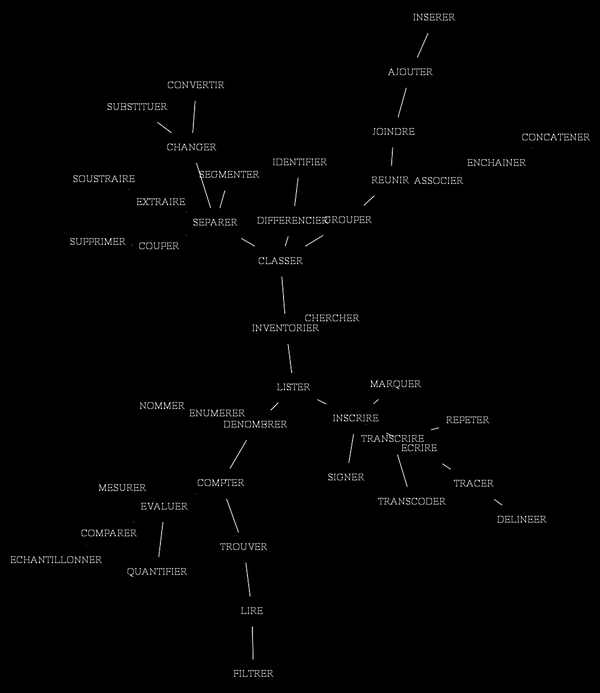

# refrains: functions and documentation

The reference version of this doc is in French, see: [refrains-fonctions.fr.md](refrains-fonctions.fr.md)

The 52 functions exported by the `:refrains` package (version 0.2.1), grouped by the sections of the menu, with their arguments and their docstring (as printed by `doc` and `help`). The name of each function links to its description in the [documentation](refrains.md) when there is one.

The resemblances between these functions, by their names and by their documentation, are drawn in the [Function trees](#function-trees).

About terminology: for the sake of simplicity and consistency, the names of the functions may change with the versions and, as far as possible, refer to an etymology common to French and English, or even to Indo-European. Since version 0.2.0, the names follow two conventions: `family-object` (`filt-median`, `graph-path`, `dist-edit`, `motif-list`…) and `source>target` for conversions (`num>base`, `str>sym`, `graph>dot`, `graph>dendrogram`…). For the functions on trees, Fred preferred *graph* to *tree*: the word is common to French and English (*graphe*, *graph*), graph theory applies to trees, and it is also used in developing refrains.

*The operations of refrains: minimum spanning tree of the (French)
verbs naming them, drawn with `graph-span` and `graph>dot` (cf. Voisin, « De la
brousse dans les synthés », in P. Criton & J.-M. Chouvel (eds.), *Gilles
Deleuze : la pensée-musique*, CDMC, 2015).*

## 1. Transcription

| Function | Arguments | Documentation |
|---|---|---|
| [`transcode`](refrains.md#transcode-seq-table-optional-test) | `seq table &optional test` | TRANSCODE: replaces each element of &lt;seq&gt; using a list of changes &lt;table&gt; with the following structure: '((old new) ...). By default test is #'eq. |
| [`num>base`](refrains.md#numbase-num-base) | `num base` | NUM&gt;BASE: converts an number to its representation in base &lt;base&gt;. |
| [`num>alpha`](refrains.md#numalpha-num) | `num` | converts list of lists and/or integers to symbols : 0 -&gt; A, 1 -&gt; B, 2 -&gt; C, 26 -&gt; AA, etc. |
| [`alpha>num`](refrains.md#alphanum-char-optional-mode) | `char &optional mode` | Converts characters or lists of characters into numbers, i.e. 'a' into 0, 'b' into 1 etc. Different modes can be selected with the optional argument mode. |
| [`list>sym`](refrains.md#listsym-list) | `list` | LIST&gt;SYM: concatenates the elements of &lt;list&gt; into one element: numbers into a number, strings into a string, other elements into a symbol. |
| [`str>sym`](refrains.md#strsym-strings) | `strings` | Converts a string or a list of strings to respectively a list or a list of lists of symbols |
| [`filt-noise`](refrains.md#filt-noise-seq-optional-mode-val) | `seq &optional mode val` | FILT-NOISE: jitters or adds some noise into sequence &lt;seq&gt; using different methods, according to the first optional argument &lt;mode&gt;, with the amount &lt;val&gt; (0.1 by default), relative to the range (max - min) of &lt;seq&gt;:  :nozero : replaces each zero value of &lt;seq&gt; with a random value in ]0, val * range[  :swap : swaps val * length pairs of elements (val integer: the number of swaps)  :relative : adds to each value a random amount in [-val * range, val * range] A sequence which is not numerical is swapped. &lt;mode&gt; may also be a function of two arguments (x l): each element x of &lt;seq&gt; is replaced by its result, l being the whole &lt;seq&gt;; &lt;val&gt; is ignored. For instance (lambda (x l) (declare (ignore x)) (nth (random (length l)) l)) replaces each element by a random element of &lt;seq&gt;. |
| [`filt-median`](refrains.md#filt-median-seq-window) | `seq window` | FILT-MEDIAN: median filter over a window of &lt;window&gt; values centred on each value of &lt;seq&gt; (an even window is enlarged to the next odd size, so that the result is made of values of &lt;seq&gt;); the first and last values are repeated at the edges. The result has the same length as &lt;seq&gt;. |
| [`filt-extrema`](refrains.md#filt-extrema-seq-window-optional-mode) | `seq window &optional mode` | FILT-EXTREMA: maximum (&lt;mode&gt; :max, by default) or minimum (:min) over a window of &lt;window&gt; values centred on each value of &lt;seq&gt;, the contrary of the median filter: the peaks (or the hollows) are widened. :open (minimum then maximum) removes the peaks narrower than the window, :close (maximum then minimum) fills the hollows narrower than the window, keeping the other values in place. An even window is enlarged to the next odd size; the first and last values are repeated at the edges. The result has the same length as &lt;seq&gt;. |
| [`filt-mean`](refrains.md#filt-mean-seq-window-optional-step) | `seq window &optional step` | Values replaced by their respective  windowed mean values. |
| [`filt-lowpass`](refrains.md#filt-lowpass-seq-alpha-optional-gamma) | `seq alpha &optional gamma` | FILT-LOWPASS: exponential smoothing of &lt;seq&gt;: each value moves by the fraction &lt;alpha&gt; (0 to 1) towards the input, s(t) = s(t-1) + alpha (x(t) - s(t-1)). With &lt;gamma&gt; (0 to 1), double exponential smoothing (Holt), which also follows the trend of &lt;seq&gt;. The result has the same length as &lt;seq&gt;. |
| [`filt-repeat`](refrains.md#filt-repeat-seq-optional-mode-test) | `seq &optional mode test` | FILT-REPEAT: removes the consecutive identical elements of &lt;seq&gt; (&lt;mode&gt; nil or :delete), or, for numbers, replaces each run of identical values by a ramp towards the next different value (&lt;mode&gt; :linear, or :interp), keeping the length of &lt;seq&gt;. &lt;test&gt;: identity of the elements (equalp by default). |
| [`filt-function`](refrains.md#filt-function-seq-func-window-optional-step) | `seq func window &optional step` | Apply function &lt;func&gt; to sequence &lt;seq&gt; thru a sliding window of length &lt;window&gt; by (optional) step &lt;step&gt; (1 by default). Window size may be an integer (samples) or a fraction of the length of seq; step size may be an integer (samples) or a fraction of the window. With step 1 the window is centred on each value; with a larger step it is centred on each block of step values. A value returned by &lt;func&gt; is repeated for the block; a list replaces the block (step = window), or gives the values of the block's positions. |
| [`graph-span`](refrains.md#graph-span-mat-dist-optional-verbose) | `mat-dist &optional verbose` | GRAPH-SPAN: minimum spanning tree build on a semi-matrix of distances &lt;mat-dist&gt;. |
| [`graph>dendrogram`](refrains.md#graphdendrogram-mat-dist-key-linkage) | `mat-dist &key linkage` | GRAPH&gt;DENDROGRAM: dendrogram of the hierarchical classification of the objects of a semi-matrix of distances or of a graph &lt;mat-dist&gt;, a list of edges (node-a node-b distance). Returns two values: the list of the successive fusions (distance group-a group-b), by increasing distance, where a group is the list of its nodes; and the dendrogram, where each fusion is (distance tree-a tree-b) and the leaves are the objects. :linkage defines the distance of two groups: :single (by default) the smallest distance of their objects, given by the minimum spanning tree (see graph-span; a graph not connected gives the list of the dendrograms of its parts); :complete the greatest distance; :average (UPGMA) the mean distance. :complete and :average need a complete semi-matrix of distances. |
| [`graph-path`](refrains.md#graph-path-from-to-graph) | `from to graph` | GRAPH-PATH: returns path(s) from node(s) or leave(s) to one or some other node(s) or leave(s) of a graph; in a graph with cycles, the shortest path by distance. |
| [`graph>dot`](refrains.md#graphdot-graph-out-key-dis-scale-shape-legend-overlap-invert) | `graph out &key dis scale shape legend overlap invert` | GRAPH&gt;DOT: converts a graph (list of edges) into an undirected graph into dot langage to be processed using neato program. Arguments: &lt;graph&gt; : the graph, as a structured list. &lt;out&gt; : if NIL or T, print out in listener; if a string, it defines the pathname of the output. Type of file define output. Keywords:  :dis : amount of distortion allowed for distances fir drawing the graph (from 0.0 for minimum distorsion to 1.0 maximum distorsion)  :scale : scaling factor for the mininum distance  :shape : string or list of strings to define node's shape, using 'neato' definitions  :legend : label the edges with their lengths (t by default)  :overlap : t (default) lets the nodes overlap; nil makes neato move them apart (useful when the lengths are short compared with the names of the nodes); a string is the value of the Graphviz overlap attribute ("scale", "prism"...)  :invert : t draws white on black instead of black on white (nil by default) |
| [`dendrogram>dot`](refrains.md#dendrogramdot-dendrogram-out-key-width-step-invert) | `dendrogram out &key width step invert` | DENDROGRAM&gt;DOT: draws a dendrogram, as given by graph&gt;dendrogram (distance tree-a tree-b), or a list of dendrograms, in dot langage with the position of each point, to be drawn by neato -n2: the leaves on the left, one by line, and each fusion at the abscissa of its distance, with a scale of the distances under the leaves. Arguments: &lt;dendrogram&gt; : the dendrogram, or a list of dendrograms (the second value of graph&gt;dendrogram for a graph not connected). &lt;out&gt; : if NIL or T, print out in listener; a stream, write into it; if a string, it defines the pathname of the output: a dot file, and, unless its type is dot, the image made by neato -n2 in the format of its type (png without type). Keywords:  :width : the width of the scale, in points (700 by default)  :step : the space between two leaves, in points (16 by default)  :invert : t draws white on black instead of black on white (nil by default) |
| [`graph>matrix`](refrains.md#graphmatrix-graph) | `graph` | GRAPH&gt;MATRIX: the symmetric adjacency matrix of &lt;graph&gt;, a list of edges (node-a node-b distance), as a list of rows: rows and columns in the order of graph-nodes, the distance of each edge, 0 elsewhere. |
| [`morph-seq`](refrains.md#morph-seq-seq1-seq2-key-test-random) | `seq1 seq2 &key test random` | MORPH-SEQ: interpolates the sequence &lt;seq1&gt; to the sequence &lt;seq2&gt; with the minimum of steps, changing one element at a time (substitution, deletion or insertion) along an edit path of minimal cost (see dist-edit): the list of the sequences from &lt;seq1&gt; to &lt;seq2&gt;, as many steps as their edit distance. &lt;test&gt;: identity of the elements (equalp by default). For equal costs, substitution is preferred, then deletion, then insertion; with :random t, one of them at random. Two strings give strings. |

## 2. Classification

| Function | Arguments | Documentation |
|---|---|---|
| [`exsample`](refrains.md#exsample-seq-method-thres-key-diff-duration-out) | `seq method thres &key diff duration out` | EXSAMPLE: samples a sequence of numerical values &lt;seq&gt; according to its signature, its salient points with some threshold &lt;thres&gt; for variation in intensity. The argument &lt;thres&gt; may be nil or 0 (no threshold for variations in intensity), or an absolute amplitude (in the unit of the values of &lt;seq&gt;, not negative): variations smaller than &lt;thres&gt; are ignored. Argument &lt;method&gt; defines the algorithm to compute the signature: :minflexmax (default, or nil), returns minima, maxima and inflexions: the minima and maxima of :minmax, and an inflexion where a plateau  which is not an extremum begins and where it ends (a plateau is a stretch of at least :duration positions where the sequence varies by less than thres); :minmax, minima and maxima only: the important extrema of :major-extrema, with \|a - b\|; :major-extrema, important extrema (Fink & Gandhi, Conference on Systems, Man and Cybernetics, 2007):  a minimum (maximum) such that the sequence rises (falls) by at least thres on both sides; :landmarks, first-order landmarks smoothed by MDPP(D, P) (Perng, Parker & Leung, Conference on Information  and Knowledge Management, 1999): pairs of close landmarks whose difference is below thres are removed. Keyword :diff, with :major-extrema and :landmarks, the difference between two values: :absolute (\|a - b\|, default), :relative (2 \|a - b\| / (\|a\| + \|b\|), as in Perng et al.) or a function (a b). Keyword :duration, a number of positions: with :minflexmax, the minimal duration of a plateau (nil, 0, 1 and 2 mean 2); with :landmarks, D (only landmarks closer than D positions may be removed; nil: no limit). A keyword not used by the method is an error. Keyword :out defines the output: :values (default, or nil), :positions, :all (position value) or :resampled (the straight lines between the points, at every position), all with the first and last values of &lt;seq&gt;; or :signature, the points (position type value), type -1 for a minimum, 1 for a maximum and 0 for an inflexion, without the first and last values. |
| [`separate`](refrains.md#separate-seq-key-marks-keep) | `seq &key marks keep` | SEPARATE: separates &lt;seq&gt; at its marks, and returns the list of its segments. A string is separated at the characters of the string :marks and at blanks. A list is separated at the elements of the list :marks (compared with equalp), at a single mark, or where the predicate :marks is true. Keyword :keep, nil (default) to remove the marks, or t to keep them: each mark begins the segment that follows it (blanks are always removed). Empty segments are removed. |
| [`graph-part`](refrains.md#graph-part-graph-optional-mode-n) | `graph &optional mode n` | GRAPH-PART: partition a graph according to edges which have maximum length. Without &lt;n&gt;, all the edges of maximum length are cut ; with &lt;n&gt;, the n-1 longest edges are cut, giving n parts. |
| [`motif-group`](refrains.md#motif-group-seq-test-optional-key) | `seq test &optional key` | MOTIF-GROUP: assembles consecutive elements or motifs of &lt;seq&gt; for which the comparison &lt;test&gt; (by default: equalp) is successful. Optional argument &lt;key&gt; defines a function to be applyed to each consecutive element or motif to be compared. |
| [`mark-structure`](refrains.md#mark-structure-seq-out-key-diss-rem-loc-dup-test) | `seq out &key diss rem-loc-dup test` | MARK-STRUCTURE: returns possible structures of input &lt;seq&gt; based on marks retrieved from &lt;seq&gt;. The output is sorted by structures's length. Use output menu &lt;out&gt; to define result form (another output is an error): :struct (or nil) lists all possible structures according to different marks of &lt;seq&gt; :pos each structure is consed to the list of positions for each segment followed by the list of the segments themselves :raw each structure is consed to the list of the different segments, each followed by all its positions in &lt;seq&gt;. Option :diss defines the dissemblance threshold to consider different segment as the same. Option :test (equalp by default) defines the identity of elements: of the marks, of the elements of the segments compared by the edit distance, and of the consecutive elements removed by :rem-loc-dup. Option :rem-loc-dup (t by default) removes the local repetitions inside each segment; positions refer to &lt;seq&gt;. |
| [`motif-structure`](refrains.md#motif-structure-seq-key-lengths-test-diss-l-var-criteria-distance) | `seq &key lengths test diss l-var criteria distance` | MOTIF-STRUCTURE: structure of &lt;seq&gt; in terms of its repeated motifs, as a list of two elements: the positions where motifs begin, each followed by the numbers of the motifs beginning there, then the motifs. A motif is a segment repeated at least once, later and without overlapping. :lengths the lengths of the motifs searched: (min max), or a maximum k for lengths 2 to k (default: 3 to half the length of &lt;seq&gt;); :test the identity of elements (equalp by default); :diss the tolerance, the maximum normalized edit distance (0 to 1) between a motif and its repetitions (0 by default: exact repetitions); :l-var the length variation of the repetitions, a fraction of the length of the motif (0 by default; used with a tolerance); :criteria :length (default) or :freq, to keep the longest or the most frequent of the motifs contained in one another; :distance a function (a b) giving the distance between two segments (lists), instead of the edit distance; :diss is then in its unit. |
| [`class-num`](refrains.md#class-num-data-classes-mode-key-iter-dist) | `data classes mode &key iter dist` | CLASS-NUM: classify a set (list) of points &lt;data&gt; into different &lt;classes&gt; into s space with n dimensions (n integer &gt; 0), where each point is represented as a list of values into each dimension. Argument :mode defines the algorithm used for partitioning the points: :centroids for centroids algorithm (in French: nuees dynamiques); :1d-centroids, initial centres taken between the largest differences of the sorted data (one dimension, deterministic). Keyword argument :iter to set the number of runs of the algorithm (with :centroids); :dist to set the distance or metric to be used (by default: euclidean distance). |
| [`class-sym`](refrains.md#class-sym-data-classes-mode-key-sub-ins-del-uncom-excluded-mst) | `data classes mode &key sub ins del uncom excluded mst` | CLASS-SYM: classify a set of segments or sequences into different classes according to their editing distance to each other and by partitioning the resulting spanning tree (see class-graph). The output is a list of numbers (from zero) as instances of the different classes retrieved. Keyword arguments :sub :ins :del :uncom for tuning editing distance (see dist-edit). The argument :excluded is a list of elements of data excluded from classification ; in the output, the numbering of the different instances begins by numbering these elements first (from zero), in the order defined with the argument :excluded. |

## 3. Evaluation

| Function | Arguments | Documentation |
|---|---|---|
| [`mark-position`](refrains.md#mark-position-seq-mark-optional-test-cons) | `seq mark &optional test cons` | MARK-POSITION: returns all positions of marks in seq. |
| [`mark-list`](refrains.md#mark-list-seq-mark-key-mark-test-seg-test) | `seq mark &key mark-test seg-test` | MARK-LIST: returns the list of all segments and their position in &lt;seq&gt; beginning with some marks defined with argument &lt;mark&gt;. If no argument mark (nil), considers all different symbols in &lt;seq&gt;. Option :mark-test defines the test function for searching the marks (equalp by default). Option :seg-test defines the test function for comparing the different segments. |
| [`motif-position`](refrains.md#motif-position-motif-seq-key-diss-l-var-sub-ins-del-uncom-test) | `motif seq &key diss l-var sub ins del uncom test` | MOTIF-POSITION: returns all positions of a &lt;motif&gt; into a sequence &lt;seq&gt;. Argument :diss is the threshold (from 0 to 1.0) of dissimilarity according to the normalized editing distance under which two different segments are considered to be the same ; argument :l-var is the threshold for variation in length of the motifs to be compared ; arguments :sub :ins :del :uncom and :test for tuning the editing distance (see dist-edit). |
| [`motif-list`](refrains.md#motif-list-seq-out-key-diss-l-var-n-sub-ins-del-uncom-test) | `seq out &key diss l-var n sub ins del uncom test` | MOTIF-LIST: returns the list of all motifs found into &lt;seq&gt; where a motif is any segment repeted at least one time according to editing distance. Output can be sorted according to the length of segment (:length, or nil) or to their frequency (:freq); another output is an error. Argument :diss is a threshold (from 0 to 1.0) of dissimilarity according to the normalized editing distance under which two different segments are considered to be the same ; argument :l-var is the threshold for variation in length of the segments to be compared ; argument :n is the maximum length of the motifs (lengths 2 to n), or a list (min max) (default: 3 to half the length of &lt;seq&gt;) ; arguments :sub :ins :del :uncom and :test for tuning the editing distance (see dist-edit). |
| [`graph-nodes`](refrains.md#graph-nodes-graph-graph-leaves-graph) | `graph` | GRAPH-NODES: list of all nodes of a graph, each node once, sorted. |
| [`graph-leaves`](refrains.md#graph-nodes-graph-graph-leaves-graph) | `graph` | GRAPH-LEAVES: returns all extremities (leaves) of a graph. |
| [`dist-euclidean`](refrains.md#dist-euclidean-a-b) | `a b` | DIST-EUCLIDEAN: euclidean distance between points a and b. Point coordinates are represented by a list of values in any euclidean space with n dimensions (n integer &gt; 0). The dimensionality of the euclidean space is defined by the list representing &lt;a&gt; and &lt;b&gt;.  If a is a list of coordinates (lists) and b null, output is the list of distances for all points to all others ;  if a or b is a number, consider b or a as list of numbers (1 dim). If a and b are lists with not same size (i.e points with not same dimensions),  returns NIL (no distance). |
| [`dist-cityblock`](refrains.md#dist-cityblock-a-b) | `a b` | DIST-CITYBLOCK: city-block distance between &lt;x&gt; and &lt;y&gt; which represent 'points' into kind of euclidean space. If &lt;y&gt; is null, &lt;x&gt; may represent a list of points, then the output is the list of city-block distances for all points to all others. |
| [`dist-hamming`](refrains.md#dist-hamming-a-b-optional-norm-test) | `a b &optional norm test` | DIST-HAMMING: Hamming distance between list a and list b. |
| [`dist-edit`](refrains.md#dist-edit-seq1-seq2-key-sub-ins-del-uncom-norm-test) | `seq1 seq2 &key sub ins del uncom norm test` | DIST-EDIT: editing distance from seq1 to seq2. Keywords arguments are: :sub : cost for substituting symbols (1 by default) :ins : cost for inserting symbols (1 by default) :del : cost for deleting symbols (1 by default) :uncom : cost for substituting symbols which are not common to both sequences :norm : result divided by the length of the longer sequence, from 0 to 1 with costs of 1 (T, or NIL by default) :test : identity function |
| [`dist-multi-edit`](refrains.md#dist-multi-edit-seq1-seq2-wgth-key-sub-ins-del-uncom-test) | `seq1 seq2 wgth &key sub ins del uncom test` | DIST-MULTI-EDIT: edit distance between seq1 and seq2, whose elements are lists of descriptors (one per dimension), the distances of the dimensions being weighted by wgth: a number (same weight for all) or a list of weights, one per dimension (a list too short is completed with its last weight, a list too long is cut). The weights are normalized to sum to 1. |
| [`dist-structure`](refrains.md#dist-structure-a-b-key-w-occ-w-rep-test) | `a b &key w-occ w-rep test` | DIST-STRUCTURE: dissimilarity between the sequences &lt;a&gt; and &lt;b&gt; from the point of view of their structure, from 0 (same structure) to 1: for each element, its number of occurrences and the position of its first occurrence are compared with the edit distance. Experimental. :w-occ, :w-rep: weights of the occurrences and of the repetitions; :test: identity of the elements (equalp by default). If &lt;b&gt; is nil, the distances between all the sequences of &lt;a&gt;. |
| [`dist-graph`](refrains.md#dist-graph-v1-v2-graph) | `v1 v2 graph` | DIST-GRAPH: distance between the nodes &lt;v1&gt; and &lt;v2&gt; of a graph: the length of the shortest path between them (Dijkstra, see graph-path), 0 from a node to itself, nil if there is no path. |
| [`histogram`](refrains.md#histogram-data-key-test-thes) | `data &key test thes` | HISTOGRAM: histogram of data, as a list of (element count): sorted by increasing value for numbers, else by decreasing count (elements of equal count in their order of first appearance). With optional arguments: test: identity test (equalp by default) thes: thesaurus or list of symbols to be considered. |
| [`entropy`](refrains.md#entropy-data-optional-mode-samples-test) | `data &optional mode samples test` | ENTROPY: entropy of the set or sequence &lt;data&gt;, according to &lt;mode&gt; (a symbol of any package, a keyword or a string): shannon-2 (or nil, default): Shannon entropy in base 2; shannon-n: Shannon entropy in base n, the number of distinct elements (from 0 to 1); shannon-e: Shannon entropy with the natural logarithm; cond-sh: conditional entropy (experimental). &lt;samples&gt;: number of consecutive windows of &lt;data&gt;, giving the list of their entropies. &lt;test&gt;: identity of the elements (equalp by default). |
| [`self-info`](refrains.md#self-info-data-elt-optional-test) | `data elt &optional test` | SELF-INFO: self-information of the element &lt;elt&gt;: -log2 of its frequency in &lt;data&gt;, nil if the element is absent or &lt;data&gt; is empty. With &lt;elt&gt; nil, each element with its information, the most informative first (elements of equal information in their order of first appearance). &lt;test&gt;: identity of the elements (equalp by default). |
| [`inner-dynamic`](refrains.md#inner-dynamic-seq-optional-test) | `seq &optional test` | INNER-DYNAMIC: a kind of inner dynamic of the distribution of the symbols (marks) of the sequence &lt;seq&gt;,  one value for each element, computed by integrating the contrast/mark analysis: novelty of the marks and their echoes  in the sequence (rewritten from Paolo Aralla's 'energy profile'). Experimental. &lt;test&gt;: identity of the elements (equalp by default). Reference: Paolo Aralla, 'Analisi morfologica. Un modello matematico per descrivere la relazione fra struttura morfologica del messaggio, attivita' mnemonico-percettiva e risposta psichica', Prisma 01, Euresis Edizioni, 2002 (sections 3 'New/Old-Analysis' and 5 'Energy-profile'). |
| [`graph-length`](refrains.md#graph-length-graph-graph-degree-node-graph) | `graph` | GRAPH-LENGTH: returns the (minimum) length of a graph (the graph must have no cycles, i.e. to a tree. |
| [`graph-degree`](refrains.md#graph-length-graph-graph-degree-node-graph) | `node graph` | GRAPH-DEGREE: degree of a node in a graph, the number of its edges (0 if it is not in the graph). A list of nodes gives the list of their degrees, nil the degrees of all the nodes, in the order of graph-nodes. |

## 4. Reading and writing

| Function | Arguments | Documentation |
|---|---|---|
| [`read-text`](refrains.md#read-text-file-key-mode-sep-rem-test) | `file &key mode sep rem-test` | READ-TEXT: reads text &lt;file&gt; using following &lt;mode&gt; formats (another mode is an error):  T : each line of file as a list of symbols or numbers  NIL : flat mode, reads file as a single list of strings  :charcode : the segments of the file, as lists of character codes. Additional keyword :sep is a string defining all characters defining a separator, besides blanks (spaces, tabulations, newlines), or t for the usual punctuation marks; with :charcode, it may also be a list of characters or codes, or (:ignore c ...) to separate at all the characters which are not letters or digits (in any alphabet), but c ... Additional Keyword :rem-test defines a function to remove choosen words. |
| [`write-list`](refrains.md#write-list-list-file-optional-mode) | `list file &optional mode` | WRITE-LIST: write list to a file using following optional argument &lt;mode&gt; format: :flat (by default) : each element of list is written in a new line, sub-lists without parentheses (as read by read-text) :lisp : list is written as a Lisp list :coll : a Max coll file, one line index, data; for each element, from index 0. |
| [`display-list`](refrains.md#display-list-list-optional-recursive) | `list &optional recursive` | DISPLAY-LIST: prints out to the Lisp listener each element of list within a newline with indentation relative to list level. |

## Documentation

| Function | Arguments | Documentation |
|---|---|---|
| [`help`](refrains.md#menu) | `&optional keyword threshold` | HELP: looks for a keyword (a symbol of any package, a keyword or a string) in the names and the documentation of the refrains functions, prints out the documentation of the functions found, the most similar first, and returns the list of their names. A word of a name or of a documentation matches if it contains the keyword, or if its similarity with the keyword (1 - normalized edit distance, case ignored) is at least &lt;threshold&gt; (0.75 by default, from 0 to 1). If no argument (keyword), prints out the list of all generic functions. |
| [`doc`](refrains.md#menu) | `&optional fct` | DOC: Prints out the documentation of some refrains function(s). If no argument, prints out the list of all generic functions. If argument is a symbol (of any package, or a keyword or a string) or a list of them, prints out documentation of the corresponding functions; list gives the list of the functions, all prints out all their documentations. Exemples: (doc) (doc 'dist-edit) |

## Function trees

The 52 functions linked by their resemblances, with refrains itself: two
minimum spanning trees (`graph-span`), drawn with `graph>dot` and neato. The
shorter an edge, the closer the two functions. The dendrogram of each tree
(`graph>dendrogram`, single linkage) orders its fusions by increasing
distance: the leaves are on the left, and each fusion is placed at the
abscissa of its distance (`dendrogram>dot`). The file
[refrains-trees.lisp](pictures/refrains-trees.lisp) computes the trees again
and redraws the images: `(load "refrains-trees.lisp")`.

**By their names**: normalized edit distance between the names, letter by
letter (`dist-edit` with `:norm t`). The families of names (`filt-`,
`graph-`, `dist-`, `mark-`, `motif-`) make branches.

**By their documentation**: Jaccard distance between the vocabularies of the
docstrings, split into words with `separate`; the words found in more than 10
of the 52 docstrings (*the*, *list*, *with*…), counted with `histogram`, are
left out. The groups there come from the vocabulary, no longer from the
names.

In the dendrogram, few functions group together below 0.75: once the common
words are left out, the vocabulary of the docstrings tells the functions
little apart.

## To do

For `graph>dendrogram`, Ward's linkage remains to be added if needed. To group the adjacent lists that intersect, use `motif-group` with the test `(lambda (a b) (intersection a b))`.
